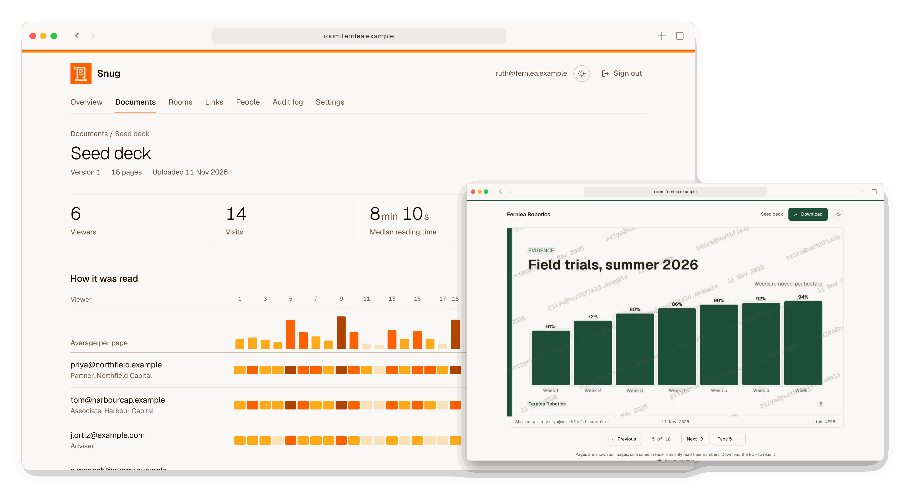
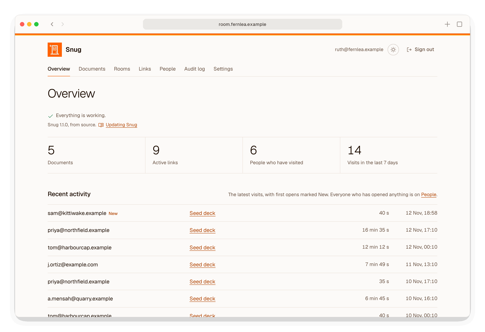
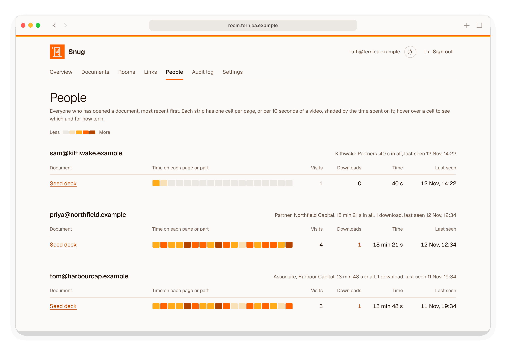
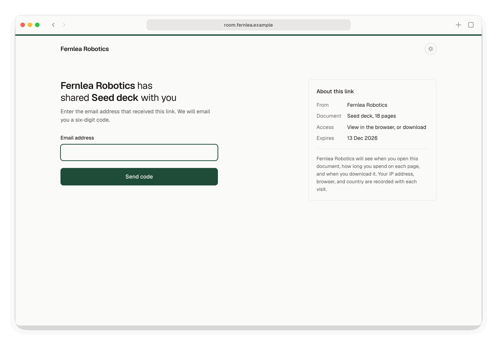
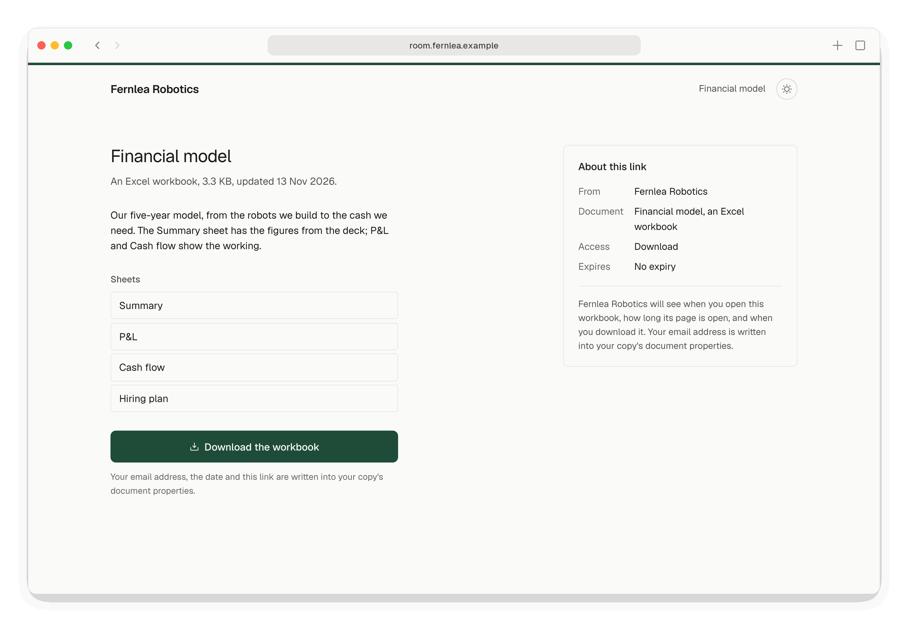

# Snug

Snug is a self-hosted data room for early-stage founders. You run it on your own server and use it to share a pitch deck or a due-diligence folder with named investors.

- Each investor gets their own link, and proves they can read the inbox it was sent to.
- You can see who opened what, page by page, and revoke a link at any time.
- Their email address is on each page they read and in each PDF or workbook they download.

<picture>
  <source media="(prefers-color-scheme: dark)" srcset="docs/images/screenshots/hero-dark.png">
  
</picture>

Snug is open source, published by [Negroni Venture Studios](https://negroniventurestudios.com/). Your documents, and the record of who read them, stay on your server and in your own encrypted backups.

## Who it is for

Founders raising a seed or Series A round who want more than a shared Drive folder, without paying monthly for a hosted data room or putting their most sensitive documents on someone else's servers.

## What Snug does

- **Documents.** PDFs, read page by page; Excel workbooks (.xlsx), shared for download so investors get the working model; and MP4 videos, watched in the browser with the viewer's watermark over them. Upload new versions; links always show the latest.
- **Rooms.** Collections of documents, with one level of folders. A document can be in any number of rooms.
- **Links.** One per person, to a document or a room, with an optional message from you. Email verification (on by default), optional expiry, downloads (on by default), and immediate revocation.
- **UK-only mode.** A link, or a whole room, can open only for visitors in the UK, Jersey, Guernsey and the Isle of Man, judged by their internet address against a country database kept on your server.
- **An NDA.** One click-through agreement for your instance, versioned, which you can require before a room or a single-document link opens. Snug records who accepted which text, and when.
- **The reader.** Pages are rendered on your server and shown one at a time, watermarked with the reader's email address, the date and the link. A download is the original PDF, stamped with the same details, so its text stays searchable. A video plays in the browser with the same details drawn over it; a workbook's card lists its sheets, and you can add a description.
- **Analytics.** Who opened each document, how long they spent on each page (or on each 10 seconds of a video), and how often they downloaded it, on an Overview, each document's page and a People page. Every admin is emailed the first time each link is opened, unless they turn it off. Reading data is deleted 12 months after a link ends, or after a period you set. Snug does not phone home.
- **An audit log** of every admin action and every viewer access, with the viewer's country, filterable and exportable as CSV.
- **Email** through Google Workspace, as a mailbox on your domain over the Gmail API, or any provider over SMTP. It is set up in Settings in numbered steps, ending with a test email, and can be cleared there.
- **Admin accounts** with a password and an authenticator app, recovery codes, invitations by email, and an email to every admin whenever the admins change.
- **Running it.** Docker Compose with Caddy for HTTPS; continuous backups to a storage bucket of your own, encrypted on your server with a key only you hold, with the last copy shown in Settings; `snug doctor`, which checks the server and reports what to fix, and a status line on the Overview showing the same, with the running version beneath it; `snug update`, which moves the server to the newest release; and `snug restore`.

You see who opened what on the Overview, and each person's reading on People:

<picture>
  <source media="(prefers-color-scheme: dark)" srcset="docs/images/screenshots/overview-dark.png">
  
</picture>
<picture>
  <source media="(prefers-color-scheme: dark)" srcset="docs/images/screenshots/people-dark.png">
  
</picture>

An investor enters a code sent to their inbox, then reads, or downloads a workbook:

<picture>
  <source media="(prefers-color-scheme: dark)" srcset="docs/images/screenshots/code-dark.png">
  
</picture>
<picture>
  <source media="(prefers-color-scheme: dark)" srcset="docs/images/screenshots/workbook-dark.png">
  
</picture>

More screenshots are in [Using Snug](docs/using-snug.md).

## What Snug does not do

- **It shows PDFs and videos, and shares Excel workbooks.** Export anything else, such as Word or PowerPoint files, to PDF first, and video to MP4 with H.264. A workbook is not previewed in the browser. Investors download it, and Snug writes their email address, the date and the link into each copy's document properties. A video's watermark is drawn over the player, so a downloaded copy has no mark, and someone determined can save a video they are watching even with downloads turned off.
- **Watermarks deter casual leaks; they cannot stop one.** Anyone can photograph a screen.
- **NDA acceptance is a record, not a signature.**
- **UK-only mode is not export control.** It goes by the visitor's internet address, so a VPN gets round it.
- It is not a hosted service, and one instance serves one company.
- No Office or image rendering, comments, e-signatures, single sign-on, investor updates or AI features.

## Status

Version 1.0.0 is the first release, with the container image `ghcr.io/negroni-venture-studios/snug:1.0.0`.

[What Snug protects against](docs/security.md) sets out the limits of its watermarks, the NDA record and UK-only mode. Planned work is in the [issues labelled enhancement](https://github.com/Negroni-Venture-Studios/snug/issues?q=is%3Aissue+is%3Aopen+label%3Aenhancement).

## Trying it on your own computer

To try Snug on a Mac, follow [Trying Snug on your own computer](docs/deploy-localhost.md). It takes about fifteen minutes, starting with installing Docker Desktop.

## Running it on a server

To put Snug on a server, follow [Putting Snug on DigitalOcean](docs/deploy-digitalocean.md), from an empty DigitalOcean account to Snug at your own address. [The deployment reference](docs/deployment.md) covers other servers. Email is set up afterwards in Settings, through [Google Workspace](docs/email-google.md) or [another provider](docs/email.md). [The backups guide](docs/backups.md) covers checking the backups and restoring from them.

## How it is built

Python and Django, with SQLite in WAL mode, server-rendered pages and very little JavaScript. PDFs are read and rendered with pypdfium2 in a separate process, limited in memory and time and confined by Linux Landlock and a filter that blocks network access and any reach into other processes, so a hostile PDF cannot reach your data. The same process checks Excel workbooks and MP4 videos, with the standard library alone; it never decodes a video, which the viewer's browser plays. Snug is one container image, run beside Caddy, Litestream and rclone. [How Snug works](docs/architecture.md) explains the code, with diagrams, and [docs/design.md](docs/design.md) the decisions behind it.

UK-only mode uses [IP geolocation by DB-IP](https://db-ip.com), licensed CC BY 4.0, which your server downloads once a month.

## Contributing and security

- [CONTRIBUTING.md](CONTRIBUTING.md) explains how to set up, test and propose changes.
- Please report vulnerabilities privately, as described in [SECURITY.md](SECURITY.md).
- [AGENTS.md](AGENTS.md) holds the working rules for AI coding agents.

## Licence

MIT; see [LICENSE](LICENSE). The Snug name and icon identify this project; if you ship a fork as your own product, please see [TRADEMARKS.md](TRADEMARKS.md).
