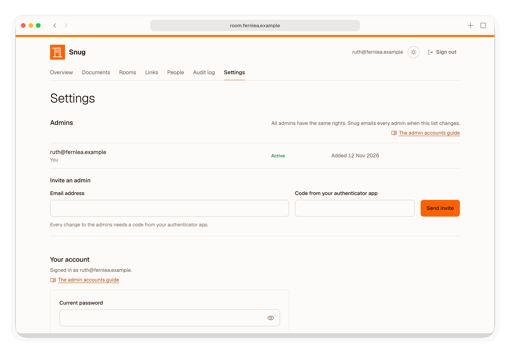
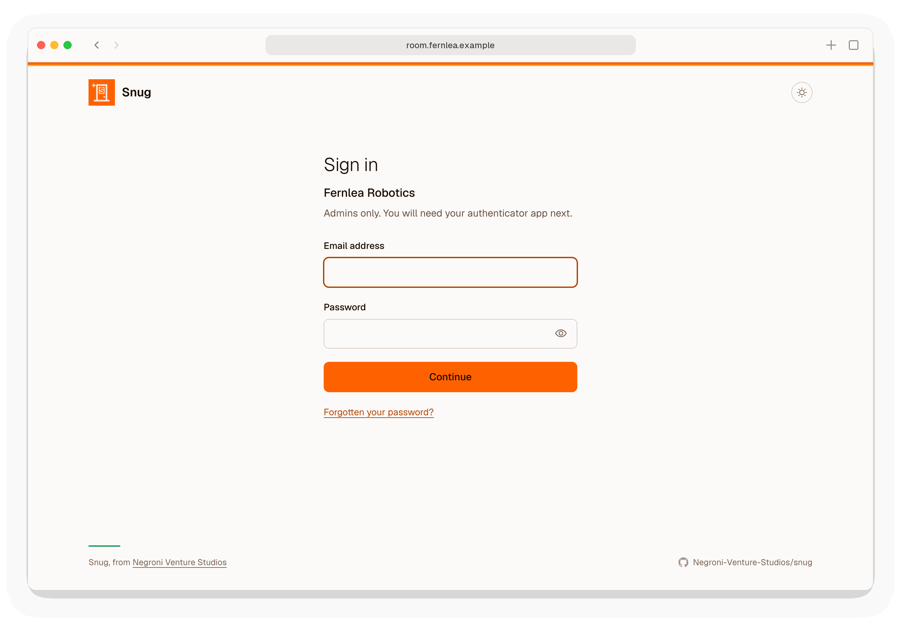
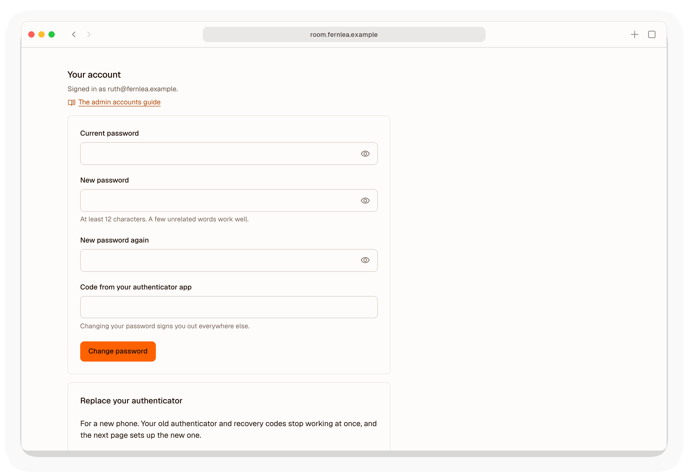

# Admin accounts

Admins are the people at your company who upload documents, issue links and read the analytics. Every admin has the same rights. Each one signs in with an email address, a password and a six-digit code from an authenticator app.

## Creating the first admin

The first admin is created on the server, from the command line:

```bash
sudo snug createadmin --email you@yourcompany.com
```

Snug then:

1. asks for a password twice. It must be at least 12 characters, and not a common password;
2. shows a QR code. Scan it with an authenticator app, such as 1Password, Google Authenticator or Authy. If you cannot scan it, type in the key printed beneath it;
3. asks for the six-digit code the app now shows. Nothing is saved until a working code is entered;
4. prints ten recovery codes.

**Store the recovery codes somewhere safe**, such as a password manager, away from your phone. Each one works once, in place of a code from the app. They are not shown again.

## Inviting another admin

Go to **Settings**, enter the person's email address under **Invite an admin**, and enter a fresh code from your own authenticator app. Snug asks for the code so that nobody at an unlocked computer can add themselves.

<picture>
  <source media="(prefers-color-scheme: dark)" srcset="images/screenshots/settings-dark.png">
  
</picture>

Snug then:

1. emails them a setup link. It works once, for 72 hours. Sending another invite to the same address replaces the link;
2. emails every admin, you included, to say who invited whom. If you ever get one of these you did not expect, sign in, remove the new admin and change your password.

The link takes them to a page where they choose a password, scan a QR code with their authenticator app, enter a code from it, and see their recovery codes once. They can then sign in.

Inviting needs email; without it, create each admin on the server with `sudo snug createadmin`, as above.

## Removing an admin

In **Settings**, choose **Remove** beside the admin, then enter a fresh code from your authenticator. They are signed out at once and can no longer sign in. The links and documents they created stay. Every admin, and the person removed, is emailed.

You cannot remove yourself, and Snug never lets the last admin be removed. For a pending invite, the same button reads **Cancel invite**.

## Resetting another admin's second factor

If another admin has lost their phone and their recovery codes, choose **Reset second factor** beside them in **Settings**, and enter a fresh code from your own authenticator. Their old authenticator and recovery codes stop working at once, and they are signed out everywhere. They are emailed a link, which works for 72 hours, to set up their authenticator again. Their password does not change, and every admin is emailed.

To replace your own authenticator, use **Replace your authenticator** in **Settings**, as described below.

## Signing in

Go to `/admin/` on your Snug domain. Enter your email address and password, then the six-digit code from your app. The code must follow within five minutes of the password.

<picture>
  <source media="(prefers-color-scheme: dark)" srcset="images/screenshots/sign-in-dark.png">
  
</picture>

- **Each code works once.** If you sign out and straight back in, wait for the app to show a new code.
- **Sessions end** after an hour without activity, and after twelve hours whatever happens.
- **Too many attempts pause signing in for 15 minutes.** The limits are:
  - 20 password attempts from one address;
  - 30 password attempts against one account, from anywhere;
  - 10 code attempts against one account;
  - 5 wrong codes after one correct password, which then takes you back to the password.

  Every attempt counts, right or wrong.

  The account limit is generous, so that someone typing wrong passwords cannot easily lock you out.
- **Changing your password or second factor signs you out in every other browser**, and in this one too for a second factor. It also stops any sign-in that is past the password and waiting for its code.

## Changing your password

In **Settings**, under **Your account**, enter your current password, the new one twice and a fresh code from your authenticator app, then choose **Change password**. You stay signed in on that browser; everywhere else is signed out. Snug emails you to say it changed, and writes the change to the audit log. The attempts share the 10-in-15-minutes limit on confirming admin changes.

<picture>
  <source media="(prefers-color-scheme: dark)" srcset="images/screenshots/settings-account-dark.png">
  
</picture>

## Forgetting your password

Use **Forgotten your password?** on the sign-in page and enter your email address. If it belongs to an admin, Snug emails a link to choose a new password.

- **The link works once, for one hour.** Asking again replaces it.
- **You also need a code from your authenticator app**, or one of your recovery codes, to set the new password. So someone who gets into your mailbox cannot change your password.
- **Five wrong codes spend the link**, and you need to ask for a new one. Codes on this page have their own limit, so they never stop you signing in.
- **The page never says whether an address belongs to an admin.** It gives the same reply, in the same time, either way.
- **Asking is limited** to 5 times from one IP address, and 3 times for one email address, in 15 minutes.
- **Changing your password signs you out everywhere**, and Snug emails you to say it changed.

Without email, ask another admin to help, or run this on the server:

```bash
sudo snug reset-password you@yourcompany.com
```

It asks for the new password twice. Like the link, it signs you out everywhere and is written to the audit log; your authenticator keeps working. Django's own `changepassword` is disabled, because it writes nothing to the audit log.

## Replacing your authenticator

For a new phone: in **Settings**, under **Your account**, find **Replace your authenticator**. Enter your password, and a code from your current authenticator app or one of your recovery codes, then choose **Replace authenticator**. Snug then:

1. stops your old authenticator and recovery codes working at once, which also signs you out everywhere;
2. takes you straight to a page that shows a new QR code, asks for a code from the new app, and shows ten new recovery codes;
3. emails you the same page's link, which works for 72 hours, in case you close the tab before finishing;
4. emails every admin to say you replaced your authenticator, and writes it to the audit log.

## Losing your phone

- If you still have your recovery codes, sign in with one of them, then replace your authenticator as above.
- If you have lost the recovery codes too, another admin can reset your second factor from the admin interface, if email is set up.
- If you are the only admin, run this on the server:

```bash
sudo snug reset-2fa you@yourcompany.com
```

It asks you to confirm, shows a new QR code, and issues new recovery codes. The old authenticator and the old recovery codes stop working at once.

## Emails when a link is first opened

The first time anyone opens a document through each link, every admin is emailed who opened it, what, when and from which country, with a link to that person on the People page. To stop them for yourself, untick *Email me when someone first opens a link* under Your account in Settings. The other admins still get theirs.

## What is recorded

Creating an admin, resetting or replacing a second factor, changing a password, and asking for and using a forgotten-password link are all written to the audit log, along with every sign-in. Passwords, authenticator keys and recovery codes are never written to the log.

## How the secrets are kept

- **Passwords** are hashed with argon2id, using Django's defaults of 100 MiB of memory and two passes.
- **Recovery codes** are random, 80 bits each, and stored only as SHA-256 hashes.
- **Authenticator keys** have to be readable by Snug to check codes, so they are stored as they are. They live in the database on your server. The standard deployment's backups are encrypted with a key only you hold.
