# Putting Snug on DigitalOcean

Setting Snug up takes about an hour, much of it waiting. Every step happens in your web browser: DigitalOcean's website has a window onto your server, called the console, where you type the few commands needed.

## Before you start

You need:

- **A DigitalOcean account**, with a payment card added. Sign up at [digitalocean.com](https://www.digitalocean.com).
- **A domain name you own**, such as `yourcompany.com`, and the login for the company you bought it from, where its DNS settings are.
- **A password manager**, such as 1Password or Bitwarden. You will make three items in it as you go.
- **An authenticator app on your phone**, such as 1Password, Google Authenticator or Authy.

Decide on the address investors will use. A part of your own domain works best, such as `room.yourcompany.com`. This guide calls it **your Snug address**.

The server and the backup storage cost about $11 a month: $6 for the server and $5 for the storage.

## 1. Create the storage for your backups

Snug copies everything to a storage bucket every five minutes, so if the server is lost, at most five minutes of changes go with it.

1. Sign in to DigitalOcean at [cloud.digitalocean.com](https://cloud.digitalocean.com).
2. Click **Create** at the top of the page, scroll to the bottom of the menu, and choose **Spaces Object Storage**.

   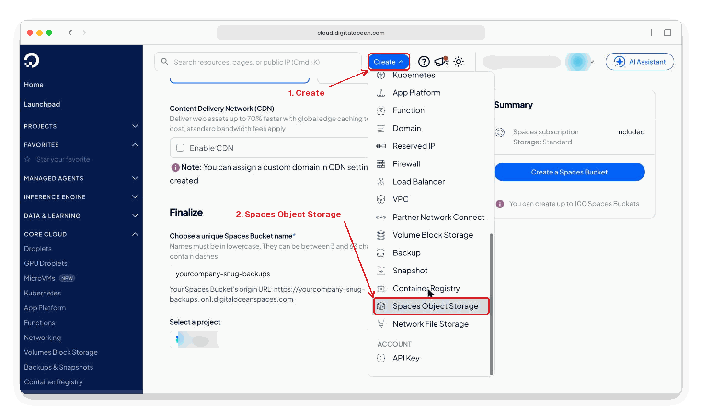

3. Under **Choose a datacenter region**, choose **London**. Leave **Standard Storage** chosen.

   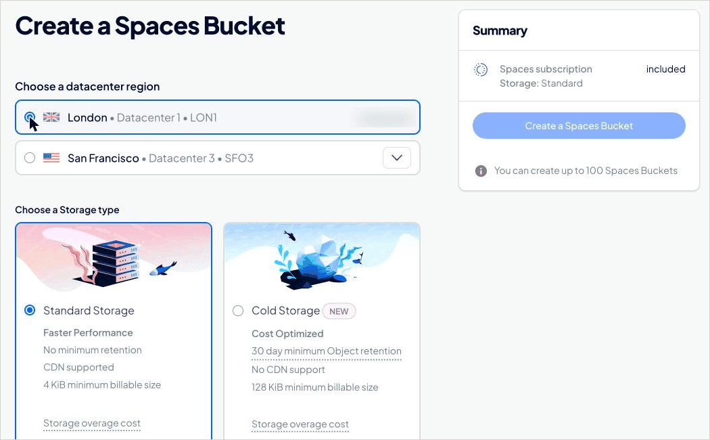

4. Further down, leave **Enable CDN** unticked.
5. Under **Choose a unique Spaces Bucket name**, type a name of your own, such as `yourcompany-snug-backups`. Every DigitalOcean customer shares the same set of names, so include your company's name. The address shown underneath should end in `lon1.digitaloceanspaces.com`.

   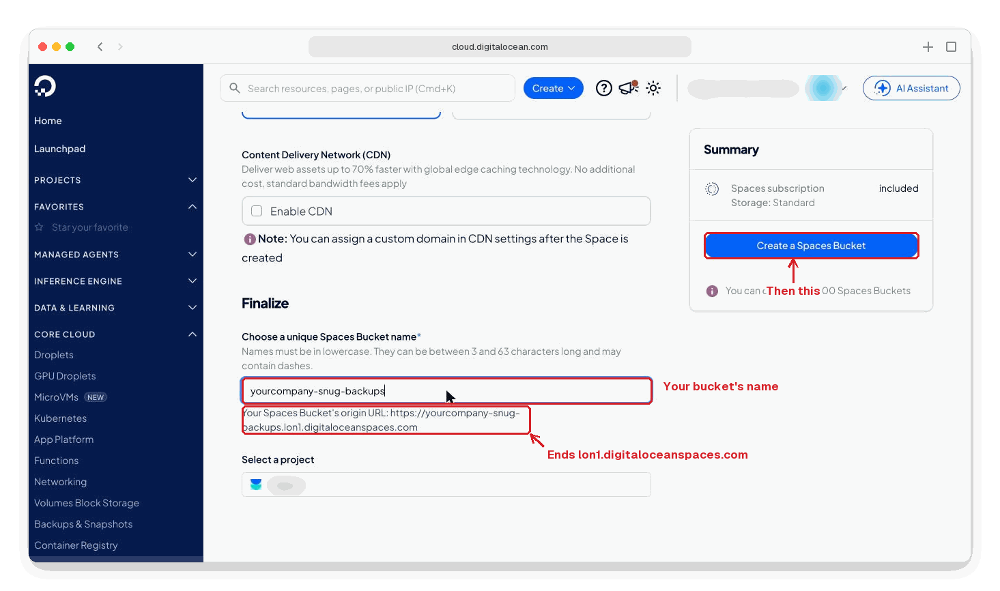

6. Click **Create a Spaces Bucket**.

In your password manager, make a new item called **Snug backups**, and write the bucket's name in it.

## 2. Create a key for the storage

1. In the menu on the left, click **Spaces Object Storage**, then the **Access Keys** tab, then **Create Access Key**.
2. Leave **Limited Access** chosen. Under **Select the buckets and permissions**, tick your new bucket, and change **Read** beside it to **Read/Write/Delete**.

   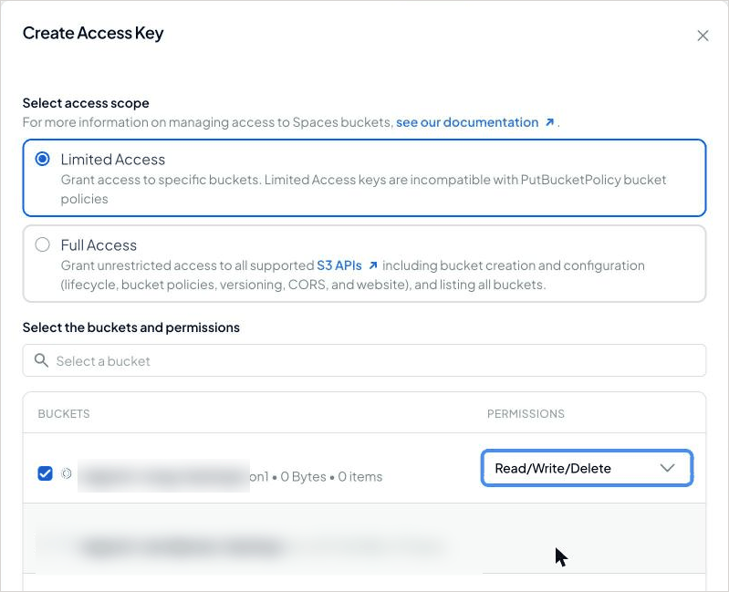

3. Under **Give this access key a name**, delete the name DigitalOcean suggests, such as `key-1794387956587`, and type `snug`.

   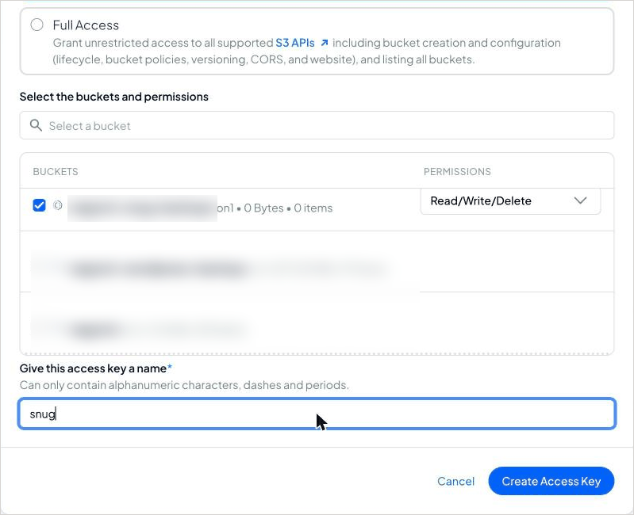

4. Click **Create Access Key**.

DigitalOcean shows the **Access Key ID** and the **Secret Key**. The secret is shown only once. Copy both into the **Snug backups** item in your password manager before you leave the page.

## 3. Create the server

DigitalOcean calls a server a droplet.

1. Click **Create** at the top of the page, then **Droplets**.
2. Under **Choose a datacenter region**, open the list, which starts at Kansas, and choose **London**, under Europe.
3. Under **Choose an image**, leave **Ubuntu** and **24.04 (LTS) x64** chosen.

   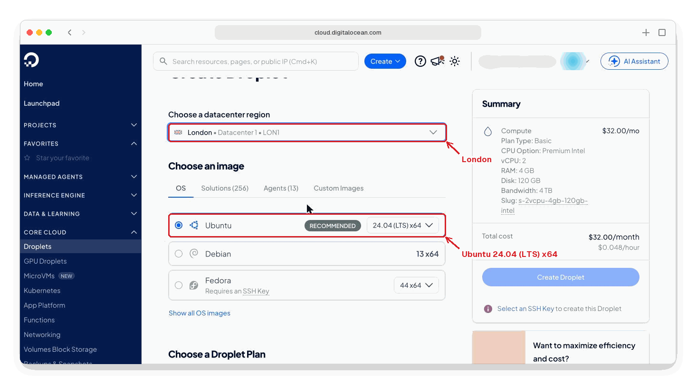

4. Under **Choose a Droplet Plan**, leave **Basic** chosen. Under **CPU Options**, choose **Regular**, then under **Select a Plan** choose **$6.00/mo**, with 1 GB of memory and a 25 GB disk. DigitalOcean picks a larger plan to begin with, and the $4 plan is too small for Snug.

   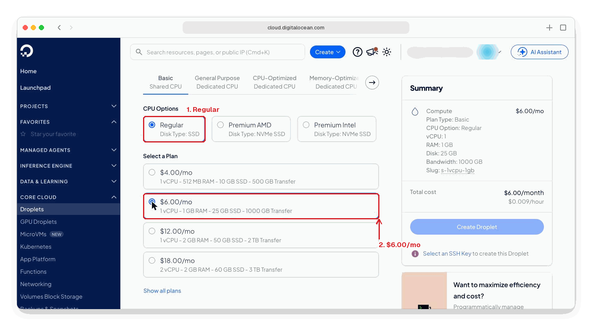

   Each video you share can be hundreds of megabytes. If you will share several, choose the $12.00/mo plan, with a 50 GB disk.

5. Leave **Backups** unticked. Snug makes its own.
6. Under **Authentication**, click **Password**. Ask your password manager to generate a password, save it as a new item called **Snug server**, and paste it into **Root password**. DigitalOcean ticks each rule it meets:
   - at least 10 characters;
   - an uppercase letter that is not the first or last character;
   - a number;
   - not ending in a number or a symbol.

   If one stays unticked, generate another.

   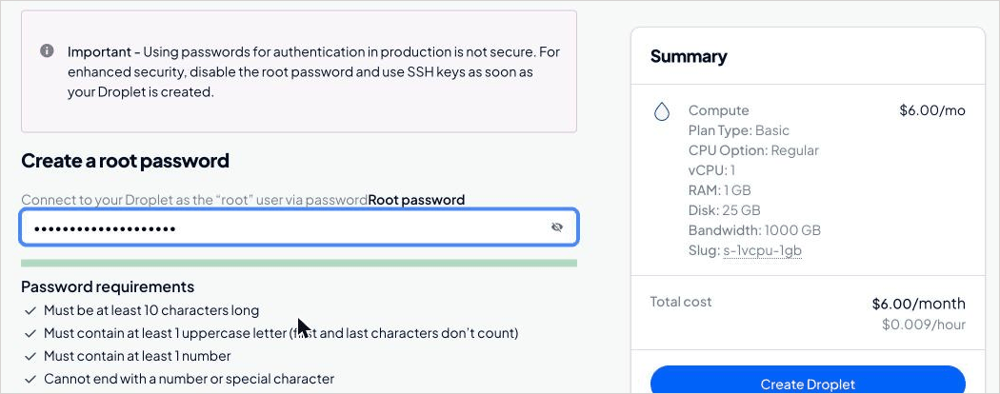

   > [!NOTE]
   > **You can use an SSH key instead of a password.** It is safer, but needs a few commands on your own computer first. DigitalOcean explains how in [Add SSH keys to Droplets](https://docs.digitalocean.com/products/droplets/how-to/add-ssh-keys/). Choose **SSH Keys**, then **Add an SSH Key**, and paste the public key. The rest of this guide is the same either way.
   >
   > 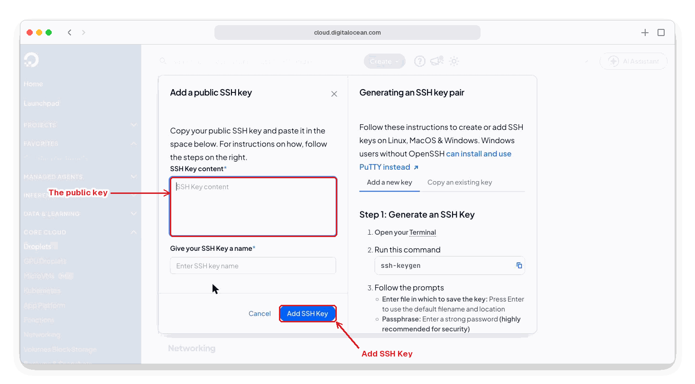

7. Under **Networking**, tick **Public IPv6 address**. Leave **Public IPv4 address** ticked.

   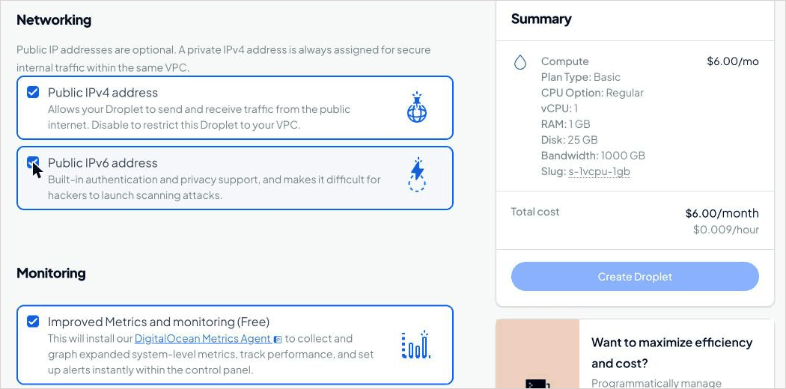

8. Under **Additional Options**, tick **Startup scripts (Free)**. A box appears, headed **Enter your scripts or data**. Open [Snug's startup script](https://raw.githubusercontent.com/Negroni-Venture-Studios/snug/main/deploy/cloud-init.yaml) in a new tab, select all of it (⌘A on a Mac, Ctrl+A on Windows), copy it, and paste it into the box. It starts `#cloud-config`.

   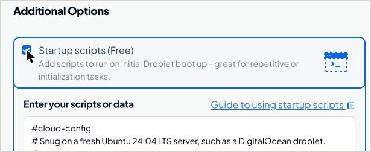

9. Under **Give your Droplet a name**, delete the name DigitalOcean suggests and type `snug`.
10. Click **Create Droplet**.

DigitalOcean opens the droplet's page. The server starts in about a minute, then spends about ten more minutes installing what Snug needs, and restarts once. Carry on with the next two steps meanwhile.

## 4. Note the server's addresses

On the droplet's page, under **Connection Details**, are its addresses. **Public IPv4** looks like `203.0.113.25`. **Public IPv6** is longer, like `2a03:b0c0:1:e0::1a2b:3001`. The button beside each copies it.

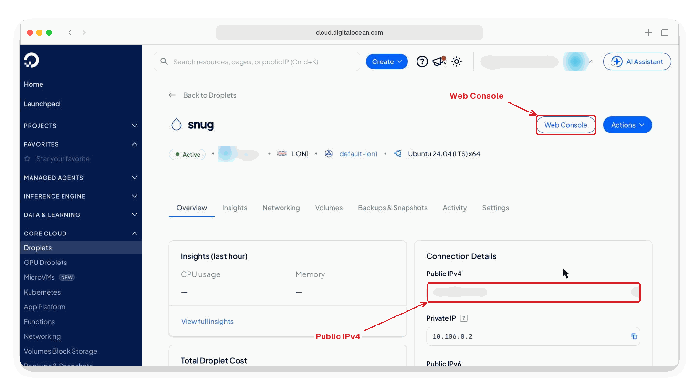

If you leave this page, you can find it again under **Droplets** in the menu on the left.

## 5. Point your Snug address at the server

Go to the website of the company you bought your domain from, sign in, and find your domain's **DNS** settings. They may be called *DNS records*, *DNS zone* or *Manage DNS*. Add two records:

| Type | Name, or host | Value, or data |
|---|---|---|
| `A` | the first part of your Snug address, such as `room` | the server's **Public IPv4** address |
| `AAAA` | the same, such as `room` | the server's **Public IPv6** address |

Leave the TTL as it is, and save. Some DNS hosts have a second button, such as **Save all changes**, at the bottom of the list.

Things that often go wrong:

- **The wrong domain.** If you own several similar domains, check you are adding the records to the one in your Snug address.
- **The whole address as the name.** Most DNS hosts want only `room`, and add `yourcompany.com` themselves. A few want `room.yourcompany.com.`, ending in a dot. If the host shows the full name beside the box as you type, check it reads your Snug address once, not `room.yourcompany.com.yourcompany.com`.
- **An old record.** If there is already a record named `room`, of type `A`, `AAAA` or `CNAME`, delete it first.
- **Waiting.** New records usually work within minutes, but can take up to an hour to reach everyone.

## 6. Open the server's console

1. On the droplet's page, click **Web Console** at the top right. A black window opens.
2. If it says `droplet-agent is not running on the target droplet`, the server is still installing. Wait five minutes, then click **Reload** in that window.

   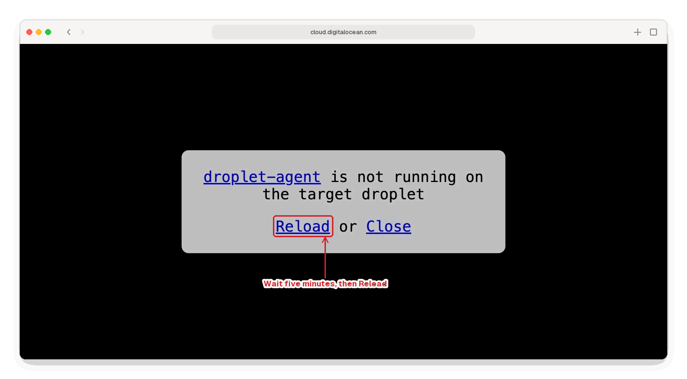

3. When the server is ready, the console shows a welcome message, and near the end:

   ```
   Snug is installed but not set up. Run: sudo snug setup

   root@snug:~#
   ```

The welcome message may say `New release '26.04.1 LTS' available`. Ignore it: Snug's setup is for Ubuntu 24.04.

If the console goes black and stops responding, it has disconnected after sitting idle. Close the window, and click **Web Console** again.

## 7. Set Snug up

In the console, type this, and press Return:

```bash
sudo snug setup
```

Snug asks one question at a time. Type each answer and press Return. To paste into the console, press ⌘V on a Mac. On Windows, right-click inside it and choose **Paste**.

| Snug asks | You type |
|---|---|
| `The domain investors will use, like room.example.com` | your Snug address, such as `room.yourcompany.com`, without `https://` |
| `Your company's name, as investors know it (you can change it later in Settings)` | your company's name, such as `Fernlea Robotics` |

If Snug says your domain `points to nowhere yet`, the DNS records from step 5 have not arrived. Carry on: Snug keeps trying. If it names an address that is not the server's, check the records.

Snug then downloads itself. The first time, this takes a minute or two. Then it asks about the backups:

| Snug asks | You type |
|---|---|
| `Are you restoring Snug from an earlier server's backups? Type yes or no [no]` | nothing: press Return |
| `Spaces region [lon1]` | nothing: press Return |
| `Bucket name` | the bucket's name, from **Snug backups** |
| `Access key` | the Access Key ID, from **Snug backups** |
| `Secret key` | the Secret Key, from **Snug backups**. Nothing appears as you paste it. Press Return. |

Snug then shows its backup settings between two lines of dashes, like this, with different values:

```
------------------------------------------------------------------------
# Snug's backups: the bucket, and the key that encrypts everything in it.
# Keep a copy of this whole file in your password manager. Without it,
# nobody can read the backups, including you.

[bucket]
type = s3
provider = DigitalOcean
access_key_id = DO00EXAMPLEKEYID
secret_access_key = an-example-secret-key
endpoint = lon1.digitaloceanspaces.com
acl = private
no_check_bucket = true

[snug-backup]
type = crypt
remote = bucket:yourcompany-snug-backups/snug
password = an-example-password
password2 = another-example-password
------------------------------------------------------------------------
Type saved once it is in your password manager:
```

**Copy everything between the lines into Snug backups in your password manager.** Then type `saved` and press Return.

Snug clears the screen, then checks its settings and starts. This takes another minute or two.

## 8. Create your admin account

Snug asks for the first admin:

| Snug asks | You type |
|---|---|
| `Email address` | your email address |
| `Password` | a new password, at least 12 characters, saved in your password manager as **Snug admin**. Nothing appears as you type. |
| `Password again` | the same password |

Snug shows a QR code. Open your authenticator app, add an account, and scan the code. If your phone cannot read it, make the console window bigger, or type the key shown under the code into the app. The app then shows a six-digit number that changes every 30 seconds.

| Snug asks | You type |
|---|---|
| `Six-digit code from the app` | the number your app shows now |

Snug shows ten recovery codes. **Copy them into Snug admin in your password manager.** Each one lets you sign in once if you lose your phone.

Setup ends with:

```
Snug is running at https://room.yourcompany.com. Sign in at https://room.yourcompany.com/admin/
Then set up email in Settings, under Email: docs/email.md explains how.
Run sudo snug doctor at any time to check everything is working.
```

## 9. Sign in

1. In your browser, go to your Snug address followed by `/admin/`, such as `https://room.yourcompany.com/admin/`.
2. Type your email address and password, click **Continue**, then type the six-digit code from your app.

If the browser says the site cannot be reached, or that the connection is not private, the DNS records have not arrived yet. Wait ten minutes and try again.

The Overview says that email is not set up yet. That is the next step.

## 10. Set up email

Snug emails each investor their link, and the codes that prove they own their inbox. Follow one of these:

- [Email through Google Workspace](email-google.md), if your company's email is Gmail on your own domain;
- [Email through another provider](email.md), for anything else.

## 11. Check everything works

Click **Overview** at the top of the admin pages. The line at the top says **Everything is working**, or what needs fixing.

For a fuller check, open the console and type this, with your own email address:

```bash
sudo snug doctor --email you@yourcompany.com
```

It emails you a code to type back, and ends with `Everything is working.` when all is well.

[Using Snug](using-snug.md) explains how to upload documents and share them.

## If something goes wrong

| What you see | What to do |
|---|---|
| The console says `droplet-agent is not running` | The server is still installing. Wait five minutes and click **Reload**. |
| The console is black and does not respond | It has disconnected. Close it and click **Web Console** again. |
| The console says `snug: command not found` | The server is still installing. Close the console, wait five minutes, and open it again. |
| The console says `Snug is still installing` | Close the console, wait five minutes, and open it again. |
| The console's welcome message, or `snug setup`, says `Snug's installation did not finish` | The installation stopped part-way, usually because a download failed. Destroy the server (on its page, **Settings**, then **Destroy**) and create a new one, as in step 3. |
| Snug says a value `contains ' (a single quote)` | Choose a value without a `'`, and run `sudo snug setup` again. |
| The browser cannot reach your Snug address | Check the DNS records in step 5. |
| The Overview shows a backup problem | **Settings**, under **Backups**, shows the reason. Check the bucket's name and key in **Snug backups** against steps 1 and 2. |
| Anything else | In the console, type `sudo snug doctor` and press Return. It lists what is wrong and how to fix it. |

To change your Snug address or company name later, run `sudo snug setup` again. It keeps your documents and accounts.

## Keeping Snug up to date

Ubuntu installs its own security updates. To update Snug, whenever [the changelog](../CHANGELOG.md) lists something you want:

1. Open the console, as in step 6.
2. Type this, and press Return:

   ```bash
   sudo snug update
   ```

Snug downloads the new version and restarts, which takes under a minute, and ends:

```
Snug is up to date. To check everything is working: sudo snug doctor
```

Your documents, links, accounts and settings are kept. The Overview shows the new version under the line at the top.

## Bringing Snug back on a new server

If the server is lost, or you want to move Snug, the backups bring everything back on a new server: documents, links, admin accounts, reading data, the audit log and the email settings. It takes about twenty minutes, most of it the new server installing itself.

You need the backup settings you saved in your password manager in step 7. Without them, nobody can read the backups.

1. **If the old server still runs, turn it off.** Open its console, as in step 6, and type `sudo snug doctor`. The `Backups` line says when Snug last copied to the bucket. Anything since then will not come back, so wait for a copy, at most five minutes, if you have just changed something. Then type `poweroff` and press Return. Never run both servers at once: they would copy over each other's backups.
2. **Create a new server**, as in step 3. Any name will do, such as `snug-2`. Choose a new root password, and save it as a new item in your password manager.
3. **Note its addresses**, as in step 4.
4. **Point your Snug address at it.** In your domain's DNS settings, change the `A` and `AAAA` records from step 5 to the new server's addresses. Change the records that are there rather than adding new ones: with both, visitors reach either server at random.
5. **Restore.** When the new server is ready, open its console, as in step 6, and type `sudo snug setup`.

   | Snug asks | You type |
   |---|---|
   | `The domain investors will use, like room.example.com` | the same Snug address as before |
   | `Your company's name, as investors know it (you can change it later in Settings)` | your company's name |
   | `Are you restoring Snug from an earlier server's backups? Type yes or no [no]` | `yes` |

   Snug asks you to paste the backup settings. Copy the whole of them from your password manager, from the first line, `# Snug's backups`, to the last, `password2 = ...`, and paste them into the console. Snug says `Found the backups: setup will restore them`, fetches them, and says:

   ```
   Snug is restored at https://room.yourcompany.com. Sign in as before.
   ```

6. **Sign in** with the same email address, password and authenticator app as before. The new server signs every admin out once. Investors' links work as they did.
7. **Check**, in the console, with your own email address:

   ```bash
   sudo snug doctor --email you@yourcompany.com
   ```

   It ends `Everything is working.` once the new server is copying to the bucket again.
8. **Delete the old server**, if it still exists. On its page, click **Settings**, then **Destroy** near the bottom. Type the server's name and click **Destroy**. Do not turn it back on: it would copy its older data over the backups.

To give the new server the old one's name, click **Edit** beside **Droplet Name** in its **Settings**.

If the new server has a different Snug address, add its address to the Google client too, as [the Google Workspace guide](email-google.md) describes. [The backups guide](backups.md) explains restoring to an earlier moment, and restoring on the same server.

[The deployment reference](deployment.md) describes how the server is set up.
