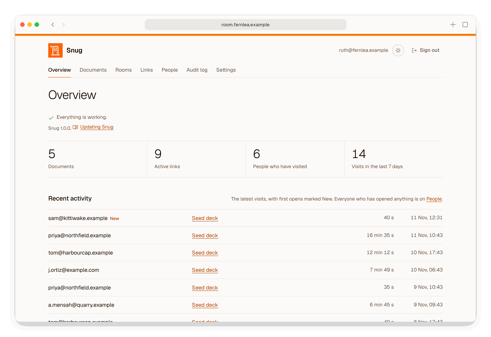

# Deployment

Snug runs on one Linux server as four containers under Docker Compose:

- Snug itself;
- [Caddy](https://caddyserver.com), which gets HTTPS certificates from Let's Encrypt, renews them, and passes every request to Snug;
- Litestream and rclone, which back Snug up, encrypted, to a storage bucket of your own, as [backups.md](backups.md) describes.

## What you need

- A server running Ubuntu 24.04 LTS. A DigitalOcean droplet with 1 GB of memory is enough for one company. Its disk holds every upload. PDFs and workbooks need little room, but a video can be hundreds of megabytes, up to `SNUG_MAX_VIDEO_MB`, 1 GB by default. Choose a disk with room for the videos you mean to share.
- A domain name, such as `room.example.com`, whose DNS `A` record points at the server, and its `AAAA` record too if the server has IPv6.
- A way for Snug to send links and codes, set up in Settings once Snug is running: a Google Workspace mailbox, through the Gmail API ([email-google.md](email-google.md)), or an email provider's SMTP details ([email.md](email.md)).
- A storage bucket for the backups, such as DigitalOcean Spaces, and a key for it. See [backups.md](backups.md).

## Setting it up

[Putting Snug on DigitalOcean](deploy-digitalocean.md) has the same steps with screenshots.

1. On DigitalOcean, create a droplet running Ubuntu 24.04 LTS with a public IPv6 address, and paste the whole of [deploy/cloud-init.yaml](../deploy/cloud-init.yaml) into *Startup scripts* under *Additional Options*.
2. Point the domain's `A` record at the server's address, and its `AAAA` record at its IPv6 address.
3. Wait a few minutes for cloud-init to finish, then sign in with SSH and run:

   ```bash
   sudo snug setup
   ```

cloud-init installs Docker from Docker's own repository, Ubuntu's automatic security updates, a firewall that lets in only SSH, HTTP and HTTPS, a 1 GB swap file, used only under memory pressure, and Snug's files in `/opt/snug`, with the `snug` command in `/usr/local/bin`. It does not start Snug.

`snug setup` asks for the domain, the company's name and the backup bucket. It generates the secret key and the backup's encryption passwords, shows you the backup settings to keep in your password manager, starts Snug, and asks for the first admin's address, password and authenticator. [admin-accounts.md](admin-accounts.md) explains the rest of the admin's setup. Email is set up afterwards, in Settings, under Email: [email-google.md](email-google.md) for Google Workspace, [email.md](email.md) for any other provider.

Run `sudo snug setup` again to change the domain or the company's name, or to add a backup bucket you skipped. On a server that already has Snug's data, it keeps the data, leaves the admins as they are and restarts Snug with the new answers.

On a new server, `snug setup` asks whether you are restoring Snug from an earlier server's backups. If you answer `yes` and paste the backup settings saved in your password manager, it restores the backups instead of starting afresh. It does the same if `/opt/snug/backup/rclone.conf` is already there and its bucket holds backups. [backups.md](backups.md) explains when you would do this.

### On another server

On any Linux server with Docker Engine and its Compose plugin, fetch the newest release's files and run `snug setup`:

```bash
sudo mkdir -p /opt/snug/backup && cd /opt/snug
release=$(curl -fsSLI -o /dev/null -w '%{url_effective}' https://github.com/Negroni-Venture-Studios/snug/releases/latest)
release=${release##*/}
for file in compose.yaml Caddyfile litestream.yml backup.sh restore.sh setup.sh update.sh snug; do
  sudo curl -fsSLO "https://raw.githubusercontent.com/Negroni-Venture-Studios/snug/$release/deploy/$file"
done
sudo install -m 755 snug /usr/local/bin/snug
sudo snug setup
```

Open ports 80 and 443 to the internet. Caddy needs port 80 to prove to Let's Encrypt that it controls the domain, and redirects everything else on it to HTTPS.

### The settings file

`snug setup` writes Snug's [settings](configuration.md) to `/opt/snug/snug.env`. To change one by hand, edit the file and run `sudo docker compose up --detach` in `/opt/snug`.

`.env` is a link to `snug.env`. Compose reads `.env` to fill in the domain for Caddy, and gives the whole of `snug.env` to Snug alone.

Compose treats `$` in `snug.env` as the start of a variable. Wrap any value containing `$`, such as some SMTP passwords, in single quotes: `SNUG_SMTP_PASSWORD='pa$$word'`.

## How the containers are set up

<picture>
  <source media="(prefers-color-scheme: dark)" srcset="images/diagrams/overview-dark.svg">
  
</picture>

| | Snug | Caddy |
|---|---|---|
| Image | `ghcr.io/negroni-venture-studios/snug` at the release's version, such as `:1.0.0`; set `SNUG_IMAGE` in `.env` to use another, such as `:edge`, a build of the latest code on `main` | `caddy`, pinned by digest |
| Data | The `snug-data` volume, mounted at `/var/lib/snug` | The `caddy-data` volume, holding its certificates |
| Ports | None on the server; only Caddy can reach it | 80 and 443, with 443 over UDP for HTTP/3 |
| Filesystem | Read-only, apart from the data folder and `/tmp` | Read-only, apart from its volumes and `/tmp` |
| Privileges | Runs as the unprivileged `snug` user, with no Linux capabilities | Only the capability to listen on ports below 1024 |

Neither can gain privileges once started (`no-new-privileges`). Litestream and the backup container are confined the same way, and run as Snug's user, which owns the data volume. Litestream has no network at all; the backup container is on a network of its own, from which it can reach the bucket but not Snug. Docker keeps at most 30 MB of each container's output.

The database in the `snug-data` volume holds the SMTP password and Google's client secret and refresh token unencrypted, so give only Snug's admins access to the server and its volumes.

Caddy writes no access log, because the token is in the URL of every investor's link.

Once a month, housekeeping downloads [DB-IP](https://db-ip.com)'s free country database, about 5 MB, for UK-only links. It is the only download Snug makes by itself. Snug looks addresses up in its own copy, so nothing about your visitors goes to DB-IP.

Otherwise Snug connects out only to send email: to Google, when it sends through Google Workspace, or to your SMTP provider. If the server reaches the internet through a proxy, set `HTTPS_PROXY` in `snug.env`. Snug's calls to Google and DB-IP use it; SMTP connects directly.

### Client addresses

Rate limits and the audit log depend on knowing each visitor's real address. Caddy has fixed addresses on the Compose network, `172.30.83.2` and `fd53:6e75:6700::2`, and Snug trusts `X-Forwarded-For` and `X-Forwarded-Proto` only from those. The Compose file sets `SNUG_TRUSTED_PROXIES` itself, overriding any value in `snug.env`. Caddy ignores any `X-Forwarded-For` a visitor sends, and passes on the address the connection really came from.

IPv6 is turned on for the Compose network. Without it, Docker would relay visitors arriving over IPv6 through a proxy of its own, and they would all reach Caddy from one address and share one set of rate limits.

## Checking it works

`snug doctor` checks the server and reports what to fix:

```bash
sudo snug doctor --email you@example.com
```

| Check | Fine when |
|---|---|
| Housekeeping | `snug housekeeping`, which runs every hour, has completed in the last 3 hours |
| Backups | The last copy to the bucket succeeded, less than 15 minutes ago ([backups.md](backups.md)) |
| Document worker | A fresh worker confines itself with Landlock ABI 4 or later and the seccomp filter, which refuses sockets and refuses to trace, signal, re-prioritise or change the limits of another process, so it is allowed to read documents |
| DNS | The domain resolves; the report lists the addresses it points to |
| HTTPS | The domain answers Snug's health check over HTTPS, with a valid certificate that has more than 14 days left |
| Email | Email is set up, through Google Workspace or SMTP; with `--email`, a code sent to that address is typed back |
| GeoIP | When anything is UK-only: DB-IP's country data is this month's or last month's |

The admin Overview shows the same problems. When there are none, it shows *Everything is working.*

<picture>
  <source media="(prefers-color-scheme: dark)" srcset="images/screenshots/overview-dark.png">
  
</picture>

It checks housekeeping, the backups, the email settings and the GeoIP data on each visit; housekeeping runs the document worker, DNS and HTTPS checks every hour, and Snug records a failed email as it happens.

Snug cannot read your inbox, so the email check sends a six-digit code and asks you to type it in. Without `--email`, `snug doctor` asks for an address, or skips the email test when it is not run in a terminal. It exits with status 1 if anything is a problem.

## Running commands

The `snug` command installed in `/usr/local/bin` runs Snug's commands inside its container, from `/opt/snug`:

```bash
sudo snug createadmin --email someone@example.com
sudo snug reset-2fa someone@example.com
sudo snug check
sudo snug doctor
```

`sudo snug setup`, `sudo snug restore` and `sudo snug update` are the exceptions. They run on the server itself, because they stop and start the containers. [backups.md](backups.md) explains `snug restore`.

## Updating

```bash
sudo snug update
```

`snug update` downloads the files in `/opt/snug` from the newest release on GitHub, as cloud-init does, and replaces them only once every one has arrived. `snug.env` and `backup/` are never touched. It then installs the new `snug` command, pulls the new images, and restarts the containers that changed. Snug applies any database migrations when it starts.

To download from another branch or tag, set `SNUG_REF`, as in `sudo env SNUG_REF=some-branch snug update`.

The Overview shows which Snug is running, under its status line: a release's version, or `edge` and the commit for a build of `main`.
