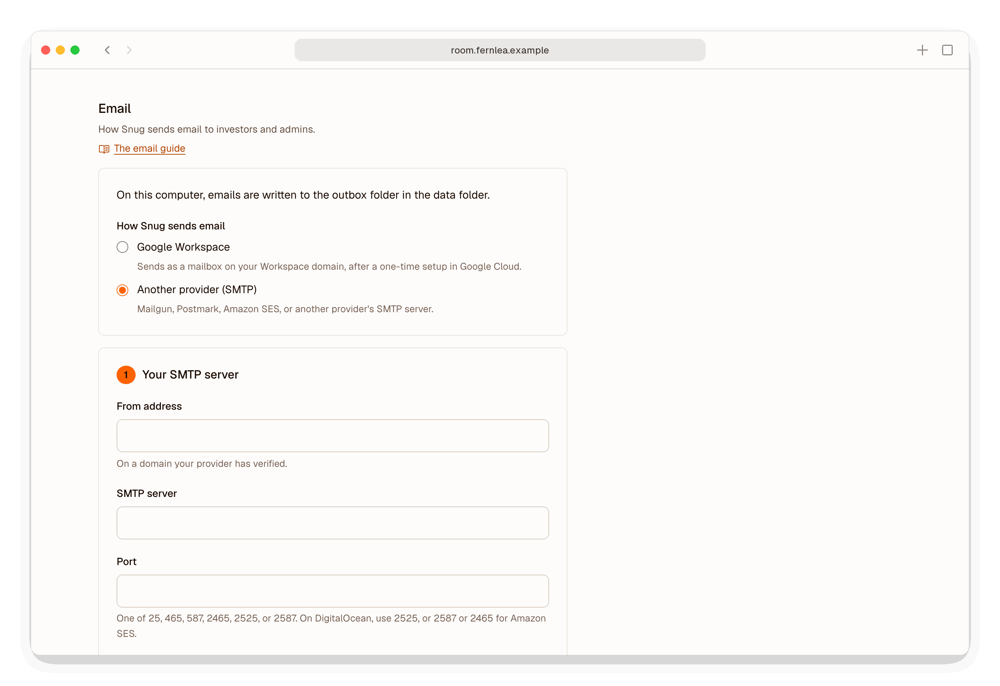

# Email

Snug sends two kinds of email to investors: links to the people you share documents with, and the six-digit codes they use to prove they own the address a link was sent to. It also emails admins: invitations, notices of changes to the admins or the email settings, an alert the first time each link is opened, a note when your password changes, and links to choose a new password or authenticator. Without working email you can still create links and send them yourself, but nobody can verify, so links that require verification cannot be opened.

**Google Workspace.** If your company uses Workspace, Snug can send as a mailbox on your domain through the Gmail API, set up as in [email-google.md](email-google.md). The rest of this guide is for any other provider, over SMTP.

Snug sends each email by the first of these routes that is set up, so SMTP settings saved in Settings, or a connected Google mailbox, take the place of the ones in `snug.env`:

<picture>
  <source media="(prefers-color-scheme: dark)" srcset="images/diagrams/email-dark.svg">
  
</picture>

Email sent from a new server, from a domain with no authentication records, goes to spam or is refused outright.

## What you need

- **A domain you control**, the one your company already uses, such as `example.com`. You will add a few DNS records to it.
- **An account with a transactional email provider** that lets you send through SMTP with a username and password. Mailgun, SendGrid, Postmark, Resend, and Amazon SES all do; so do many others.

Do not send through a personal Gmail or Outlook account. Their limits are low, and messages sent through them are judged by their domain's reputation.

## Step 1: choose the sending address

Choose the address Snug's emails come from, on your own domain, such as `rooms@example.com`. People will see it, so make it plain.

Each link email is set to reply to the admin who sent it, so an investor who replies reaches a person. The sending address only needs to exist if your provider insists on it.

## Step 2: verify your domain with the provider

Add your domain in the provider's dashboard. The provider then gives you DNS records to add at your DNS host (your registrar, Cloudflare, or wherever your domain's records are kept). There are usually three kinds.

### DKIM

DKIM signs each message with a key that only your provider holds, and publishes the matching public key in your DNS. It is the record that matters most, since it proves to Gmail and Outlook that the message really came from your domain.

The provider gives you one or more records, usually `CNAME` or `TXT`, with names like `pm._domainkey.example.com` or `s1._domainkey.example.com`; copy them exactly. Some DNS hosts add your domain to the end of every name automatically, so `pm._domainkey` may be all you should type.

### SPF

SPF lists the servers allowed to send mail for your domain. It is a `TXT` record on the domain itself, starting `v=spf1`.

**A domain can have only one SPF record.** If you already have one, for Google Workspace or Microsoft 365 say, do not add a second: add the provider's `include:` to the existing record. For example, if you have

    v=spf1 include:_spf.google.com ~all

and your provider asks for `include:mailgun.org`, change it to

    v=spf1 include:_spf.google.com include:mailgun.org ~all

Two SPF records make both invalid, and that breaks your ordinary email as well as Snug's.

Many providers instead ask you to point a subdomain, such as `bounces.example.com`, at them with a `CNAME` or `MX` record, and handle SPF there. If so, follow their instructions and leave your main SPF record alone.

### DMARC

A DMARC record sets what receiving servers should do with mail that claims to be from your domain but fails DKIM and SPF, and where to send reports. It is a `TXT` record named `_dmarc.example.com`. If you do not have one, start with:

    v=DMARC1; p=none; rua=mailto:dmarc@example.com

`p=none` asks for reports without affecting delivery. Once the reports show that your real mail passes, which usually takes a couple of weeks, change it to `p=quarantine`.

If you already have a DMARC record, leave it as it is.

### Wait, then check

DNS changes can take up to a day to spread, though usually it is minutes. Wait until the provider's dashboard shows the domain as verified before going on.

## Step 3: get the SMTP details

From the provider's dashboard, note:

- the SMTP host name, such as `smtp.mailgun.org`;
- the port (see the next section if you are on DigitalOcean);
- a username and password. Many providers call these SMTP credentials, or ask you to create an API key and use it as the password. Create one for Snug alone, so you can revoke it without affecting anything else.

### On DigitalOcean: use another port

**DigitalOcean blocks outgoing connections on ports 25, 465, and 587 from every droplet.** These are the usual SMTP ports, so Snug cannot reach your provider on them, and every email fails with a time-out.

Many providers also listen on another port for this reason. Mailgun, SendGrid, and Postmark accept port 2525; use it with STARTTLS as the encryption (`SNUG_SMTP_SECURITY=starttls` in `snug.env`). Amazon SES and Resend accept 2587 with STARTTLS, and 2465 with TLS. Snug accepts ports 25, 465, 587, 2465, 2525, and 2587, so a provider whose only other port is something else cannot be used from DigitalOcean.

You can check from the droplet whether a port is open:

```bash
nc -zv -w 5 smtp.mailgun.org 2525
```

"succeeded" means the port is open. A time-out means it is blocked.

## Step 4: configure Snug

Sign in, open **Settings**, and under **Email** choose **Another provider (SMTP)**. Snug lays the setup out in two numbered steps. Fill in step 1, **Your SMTP server**:

<picture>
  <source media="(prefers-color-scheme: dark)" srcset="images/screenshots/settings-email-dark.png">
  
</picture>

- the address emails come from, on the domain you verified;
- the SMTP server, port, username, and password or API key from step 3;
- the encryption: STARTTLS for ports 587, 2525, and 2587, or TLS for ports 465 and 2465;
- a code from your authenticator app.

Every admin is emailed about the change. Snug refuses a server whose name leads to a private or internal address.

Choose **Save**, and Snug uses the new settings at once, with no restart. The page moves on to step 2, **Send a test**. The password is never shown again. To change it, type a new one, or leave the box empty to keep it.

Emails use your company's name, as set in Settings under Branding, such as "Fernlea Robotics has shared Seed deck with you".

Email can also be set in `snug.env`, with the `SNUG_SMTP_` settings [configuration.md](configuration.md) lists. Snug uses those until SMTP settings are saved in Settings or a Google mailbox is connected there. To go back to them, or to stop email altogether, use **Clear email settings**, under the choice of provider at the top of Email, and enter a code. It appears once anything is saved.

## Step 5: send yourself a test

In step 2, choose **Send a test**. Snug emails you, and says at once if the email could not be sent. On the server, `sudo snug doctor --email you@example.com` sends a six-digit code to that address and asks you to type it back.

Then try a real link. Open a document in the admin interface, choose **New link**, enter an address of your own, and choose **Create and email**. If the email cannot be sent, Snug says so on the next page and shows you the link to copy instead.

When the email arrives, check that it passed authentication. In Gmail, open the message, choose **Show original** from the menu, and look for:

    SPF:   PASS
    DKIM:  PASS
    DMARC: PASS

In Outlook, view the message source and look for `dkim=pass` and `dmarc=pass` in the `Authentication-Results` header. If DKIM or DMARC did not pass, go back to step 2.

Try an address at a different provider from your own too, since a domain's own mail servers are often more forgiving of its mail than Gmail or Outlook are.

## When it goes wrong

Snug logs only the kind of error. The admin Overview shows a problem when an email could not be sent. Look for a line such as `Email could not be sent: SMTPAuthenticationError` in Snug's log, with `sudo docker compose logs snug` in `/opt/snug`.

| What you see | Likely cause |
|---|---|
| `TimeoutError` or a long pause, then failure | The port is blocked. On DigitalOcean, see [Use another port](#on-digitalocean-use-another-port). |
| `SMTPAuthenticationError` | The username or password is wrong, or the API key has been revoked or lacks permission to send. |
| `SMTPSenderRefused` | The From address (in Settings, or `SNUG_EMAIL_FROM` in `snug.env`) is not on a domain your provider has verified. |
| `SSLError` | The encryption (in Settings, or `SNUG_SMTP_SECURITY` in `snug.env`) does not match the port: try STARTTLS for 587, 2525, or 2587, and TLS for 465 or 2465. |
| Emails arrive, but in spam | DKIM or DMARC is not passing. Check the message's authentication results, as in step 5. A new domain or provider account may also need a few days of low volume to build a reputation. |
| Emails arrive for some people but not others | Check your provider's dashboard for bounces and blocks. Some company mail filters hold messages containing links until the recipient releases them. |

## On your own computer

When `SNUG_DOMAIN` is `localhost` and `SNUG_SMTP_HOST` is not set, Snug writes each email to a file in the `outbox` folder inside `SNUG_DATA_DIR` instead of sending it. Open the files to read the links and codes. To test a real provider from your computer, set the SMTP variables as above; your home connection is unlikely to block the usual ports.
