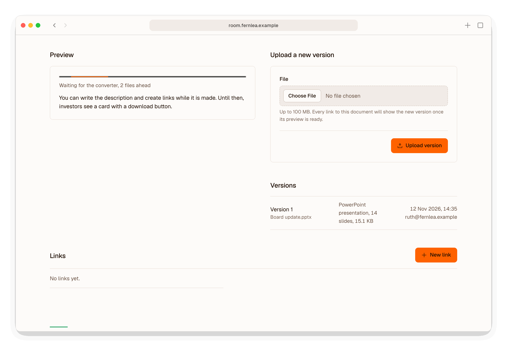
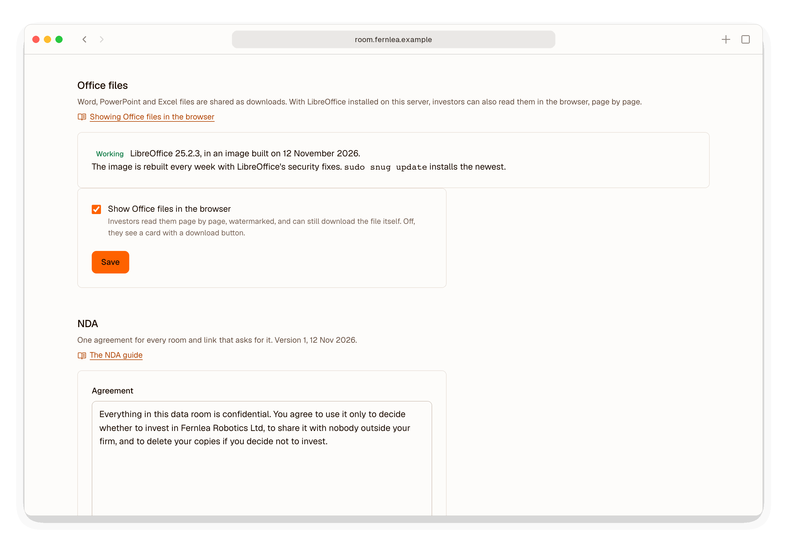

# Showing Office files in the browser

Snug shares Word, PowerPoint and Excel files as downloads. With LibreOffice installed on your server, investors can also read them in the browser, page by page, as they read a PDF. Each page shows their email address as a watermark, and Snug records the time they spend on it.

LibreOffice is optional, and runs in a container of its own under gVisor, with no network.

## What investors see

A presentation, document or workbook opens in the reader, one page at a time. Each slide is a page. Each sheet of a workbook is one page, sized to the sheet, so its columns are never split across pages; a long or wide sheet is shown smaller. The *Download* button gives the file itself, with the investor's email address, the date and the link written into its document properties.

Until a file's preview is ready, or if one could not be made, investors see the file's card, with your description and a download button.

## What you see

When you upload an Office file, Snug saves it and returns at once. The document's page shows the preview being made, with how many files are ahead of it, and you can write the description and create links meanwhile. LibreOffice takes about 15 seconds a file, and converts one file at a time.

A new version of a document waits for its preview before links show it, so an investor reading pages never drops back to a card. Until then, the document's page shows which version is being prepared, and links show the previous one.

<picture>
  <source media="(prefers-color-scheme: dark)" srcset="images/screenshots/office-preview-dark.png">
  
</picture>

If a preview cannot be made, the document's page shows the reason and a *Try again* button. Investors can still download the file.

*Settings*, under *Office files*, shows the LibreOffice version, when the converter's image was built, and a switch for showing Office files in the browser. With it off, investors see cards with a download button again.

<picture>
  <source media="(prefers-color-scheme: dark)" srcset="images/screenshots/settings-office-dark.png">
  
</picture>

## Installing LibreOffice

The converter needs a server with 2 GB of memory, such as DigitalOcean's $12 a month droplet. On a server with 1 GB, LibreOffice can use enough memory to stop Snug, so `snug setup` and `snug update` warn you before installing it there.

`snug setup` asks whether to show Office files in the browser. On a server already running Snug:

```bash
sudo snug update --with-office
```

The command installs gVisor from gVisor's own packages, restarts Docker and with it Snug, and starts the converter. Snug then converts the current version of each Office document you have already uploaded, one at a time and oldest first.

## Keeping it up to date

Snug's converter image is rebuilt every Monday with Debian's latest LibreOffice, and `sudo snug update` installs it. *Settings* and `sudo snug doctor` show a warning when the image on your server is more than 14 days old.

## Removing it

```bash
sudo snug update --without-office
```

Office files become cards with a download button again. Their previews stay on the server, and are shown again if you install LibreOffice later.

## What it costs in security

LibreOffice is millions of lines of C++, with import filters for hundreds of file formats. It publishes security fixes several times a year, many of them for bugs in reading files. Adding it gives an attacker a large new target, so it is optional, and it runs confined.

Only signed-in admins upload files, so nobody on the internet can send a file straight to LibreOffice. An attack needs either a stolen admin account or a malicious file that reaches you first, such as a 'revised term sheet' from someone posing as a lawyer.

## How it is confined

A file passes through five layers on its way to a preview.

1. **Snug's checks before conversion.** Snug's checker reads every Office file in its confined document worker, whether or not LibreOffice is installed. It refuses to take a file with macros, ActiveX controls or embedded objects; one that fetches a template, picture or object from another computer when it opens; a Word field that fetches content or starts another program; or a workbook linked to another program. The upload is refused with the reason, so you can save the file without it and upload it again. LibreOffice is then told which import filter to use, from the kind the checker found, so it never chooses one from the file's contents.
2. **A container of its own.** The converter runs under gVisor, which puts its own kernel between LibreOffice and the server's. The container has no network, a read-only file system, no Linux capabilities and its own user, and is limited to 1 GB of memory, 256 processes and one CPU. It holds no Snug settings or secrets. It shares two folders with Snug: a read-only one holding the file to convert, and a writable one for the PDF.
3. **One file per container.** The converter converts a single file and exits, and Docker starts a fresh container for the next, so no process or temporary file is kept between conversions.
4. **LibreOffice's own limits.** LibreOffice gets a fresh profile for each file, with macros and link updates turned off, an empty environment, limits on CPU time and file size, two minutes to finish, and a seccomp filter that refuses network sockets and any reach into another process. If the filter cannot be applied, the file is not converted.
5. **Snug's checks after conversion.** Snug reads the converter's output without following symbolic links, and takes only the PDF for the file it sent. Its confined worker then reads that PDF before any investor sees a page.

An attacker who took over LibreOffice through a file would have access only to that file and its PDF. The container has no network, no Snug database, no other documents and no secret key. [What Snug protects against](security.md) covers the rest of Snug.
