# Using Snug

You run Snug from its admin pages, at `/admin/` on your domain. Each investor gets a link of their own, which opens only the document or room you shared with them. The screenshots here are from a demo data room for a made-up company, Fernlea Robotics.

## Signing in

Sign in with your email address and password, then the six-digit code from your authenticator app. [Admin accounts](admin-accounts.md) covers creating the first admin, inviting others, and what to do if you lose your phone.

<picture>
  <source media="(prefers-color-scheme: dark)" srcset="images/screenshots/sign-in-dark.png">
  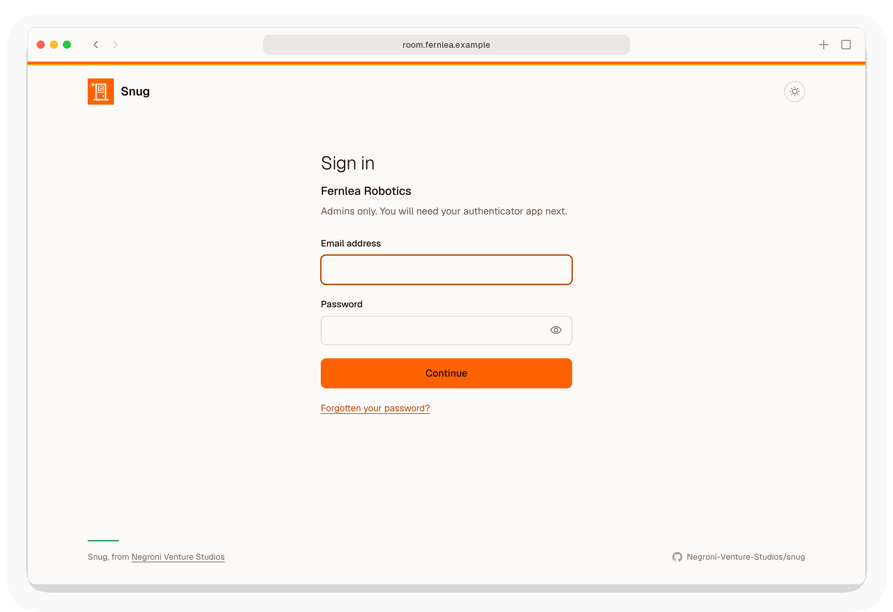
</picture>

## The Overview

The Overview is the first page after signing in. A line at the top says whether everything is working, or shows any problem `snug doctor` would report, such as a late backup. Under it is the version of Snug running, such as *Snug 1.0.0*, with a link to *Updating Snug*. Next come the number of documents, active links, people who have visited and visits in the last week, then the latest visits, with a person's first open of a document marked *New*.

<picture>
  <source media="(prefers-color-scheme: dark)" srcset="images/screenshots/overview-dark.png">
  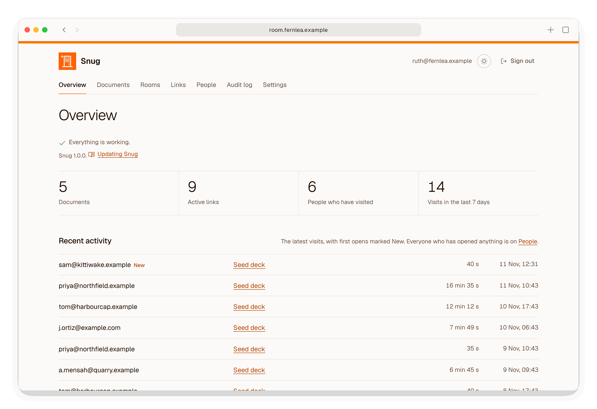
</picture>

## Uploading a document

Choose *Documents*, then *Upload a document*. Give it a title, which investors see, and choose the file: a PDF, an Excel workbook (.xlsx) or an MP4 video. Snug checks the file before it keeps it, and says what is wrong with one it refuses, such as a workbook with macros or a PDF with a password.

<picture>
  <source media="(prefers-color-scheme: dark)" srcset="images/screenshots/upload-dark.png">
  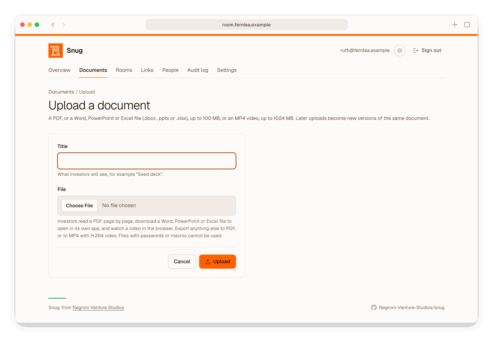
</picture>

To replace a document, upload a new version from its page. Every link to it shows the new version at once, and the old reading data stays.

<picture>
  <source media="(prefers-color-scheme: dark)" srcset="images/screenshots/documents-dark.png">
  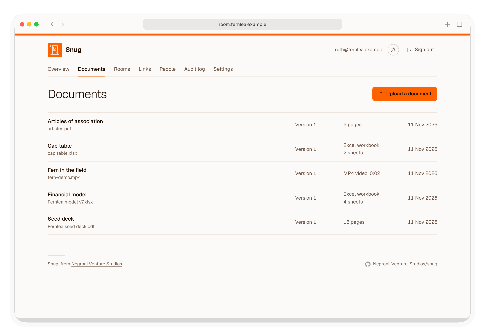
</picture>

## Seeing who read what

A document's page has its numbers at the top: viewers, visits, the median reading time and how many read every page. *How it was read* has a bar for each page, the average time spent on it, and below it a strip for each person, one cell per page, shaded by their time. Hover over a cell to see the page and the time.

<picture>
  <source media="(prefers-color-scheme: dark)" srcset="images/screenshots/document-dark.png">
  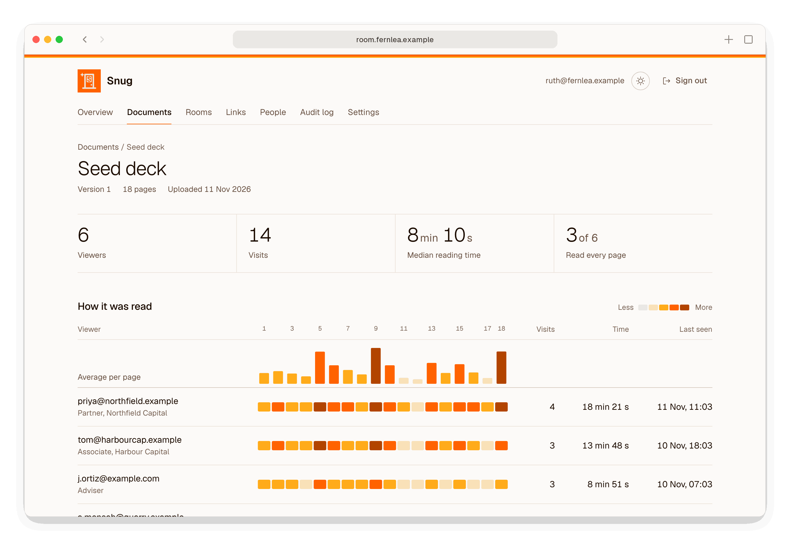
</picture>

A workbook has no pages, so its page has a description, which investors see above its list of sheets, and the sheets themselves. A video's page has a player, and its chart counts time in parts of 10 seconds.

<picture>
  <source media="(prefers-color-scheme: dark)" srcset="images/screenshots/workbook-admin-dark.png">
  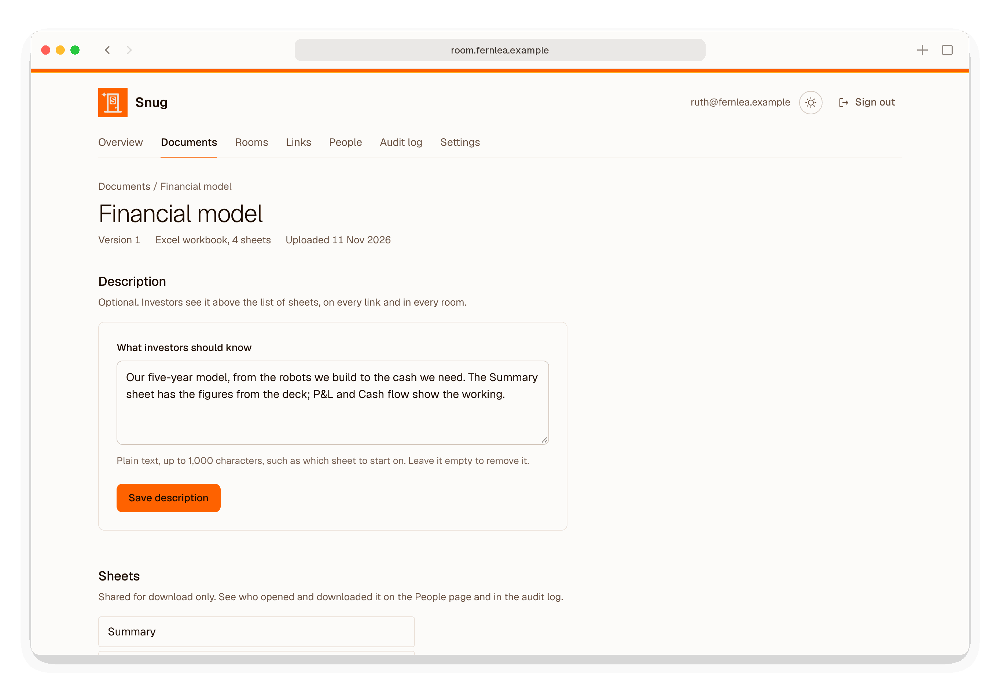
</picture>

*People* has everyone who has opened anything, most recent first, with what each person opened, how often they visited and downloaded, and their time.

<picture>
  <source media="(prefers-color-scheme: dark)" srcset="images/screenshots/people-dark.png">
  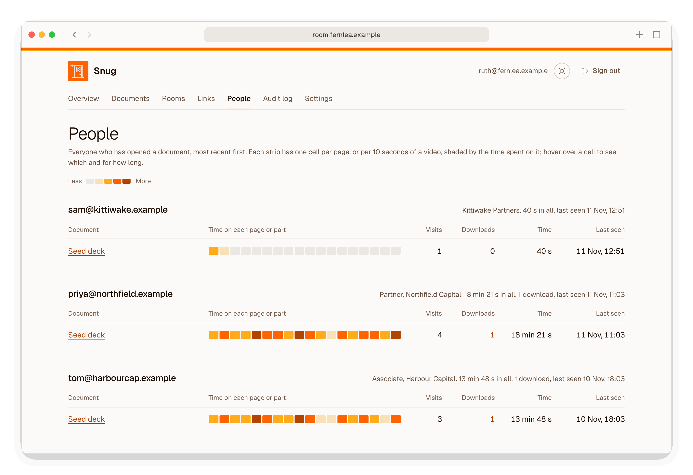
</picture>

You are emailed the first time each link is opened. To stop it, untick *Email me when someone first opens a link* under *Your account* in Settings.

## Sharing a document

Each link is for one person. On a document's page, choose *New link*, and fill in:

- **Email address**: the person you are sending it to. *Require email verification* is ticked to begin with, so they must type a code Snug emails to that address before they see anything.
- **Note for yourself**: who they are, such as "Partner at Northfield Capital". Only admins see it.
- **Message for them**: optional. They see it in the *About this link* panel on each of their pages, and in the email with the link.
- **Expires**: optional. The link stops working at the end of that day.
- **Ask for the NDA first**, **Only from the UK** and **Allow download**, as you need them. The NDA is set up once, in Settings; [the NDA guide](nda.md) explains it.

<picture>
  <source media="(prefers-color-scheme: dark)" srcset="images/screenshots/link-new-dark.png">
  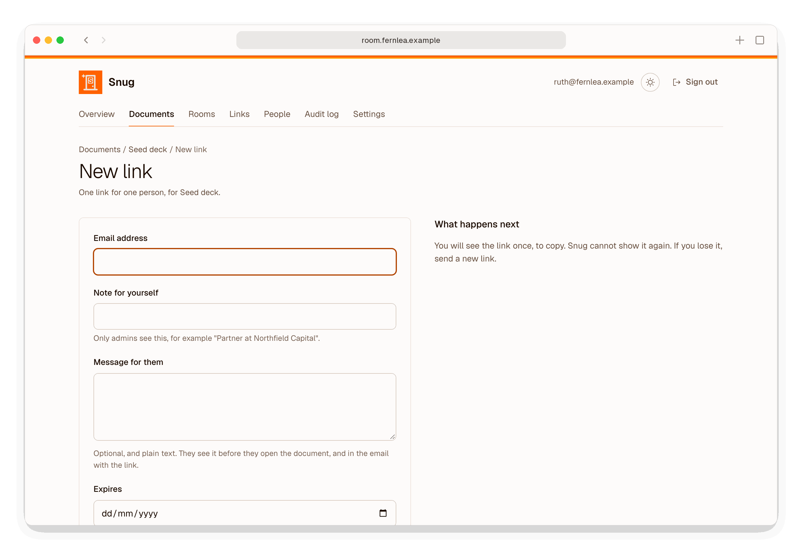
</picture>

*Create and email* sends it; *Create and copy* shows the link once, to send yourself. If it is lost, send a new link.

*Links* lists every link, newest first. *Revoke* stops a link at once, even for someone reading it at the time. *New link* replaces it with a fresh one for the same person, with the same settings and history.

<picture>
  <source media="(prefers-color-scheme: dark)" srcset="images/screenshots/links-dark.png">
  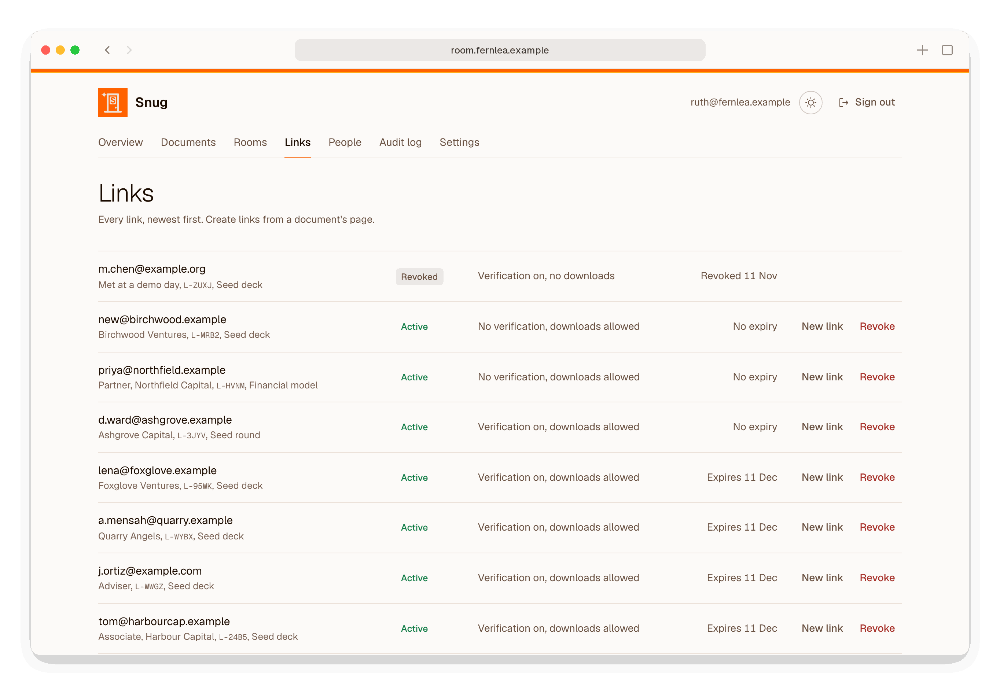
</picture>

## Rooms

A room shares several documents through one link, in folders one level deep, such as Company, Financials and Legal. A document can be in any number of rooms. Removing a document from a room closes it to every link to that room at once.

<picture>
  <source media="(prefers-color-scheme: dark)" srcset="images/screenshots/room-dark.png">
  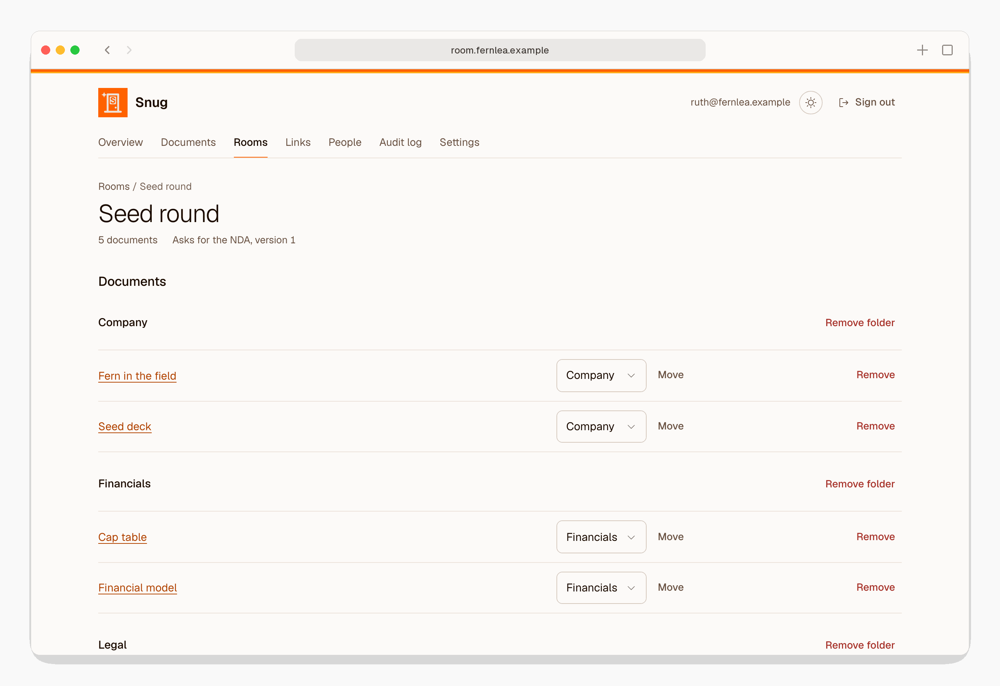
</picture>

A room can require the NDA, or admit only visitors in the UK, for every link to it. Its page has its own *New link*.

## What an investor sees

A link opens a page with your company's name, what has been shared and a panel listing what you will see of their visit. If the link requires a code, they type the email address it was sent to, and Snug emails them six digits.

<picture>
  <source media="(prefers-color-scheme: dark)" srcset="images/screenshots/code-dark.png">
  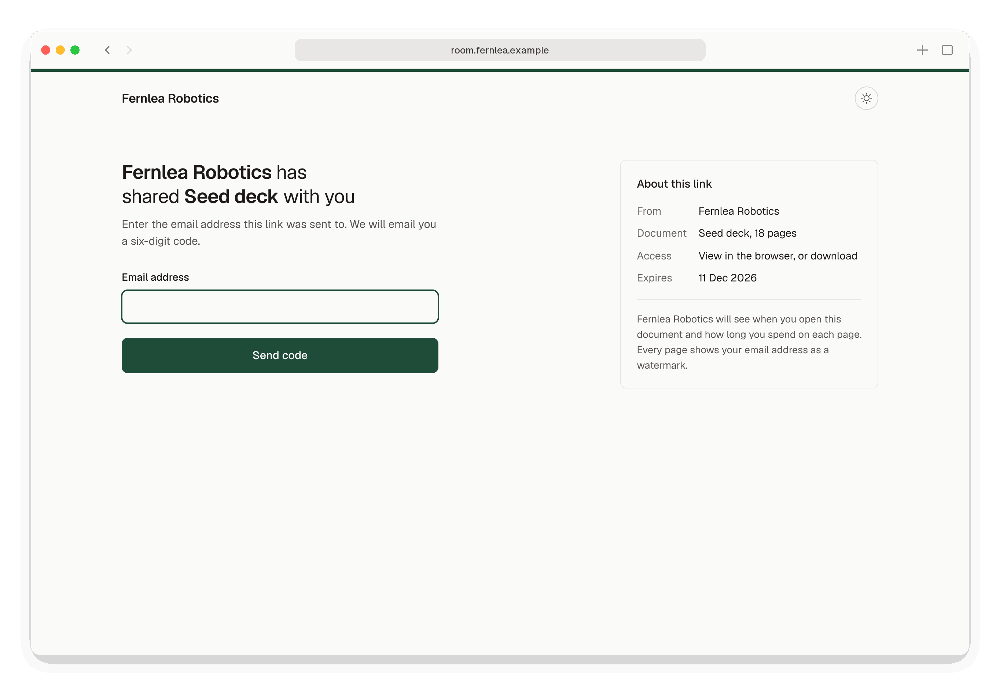
</picture>

If the link requires the NDA, they read it, type their name and tick to accept before they see anything.

<picture>
  <source media="(prefers-color-scheme: dark)" srcset="images/screenshots/nda-dark.png">
  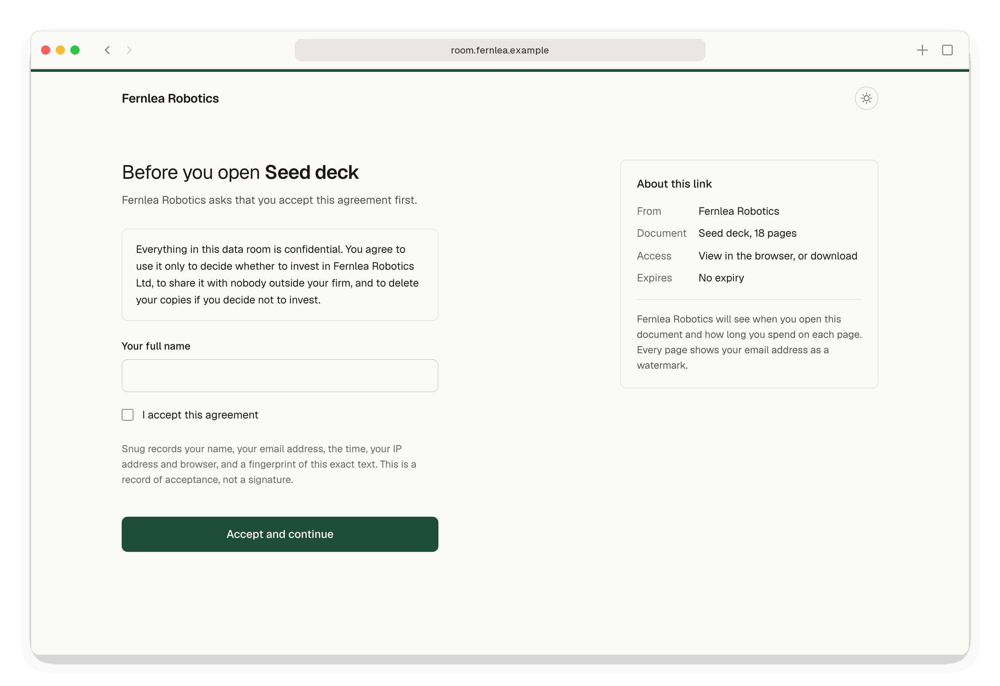
</picture>

A PDF is shown a page at a time, with their email address and the date across it and a line at the foot of each page. They can download it, if the link allows, with the same details stamped on every page.

<picture>
  <source media="(prefers-color-scheme: dark)" srcset="images/screenshots/reader-dark.png">
  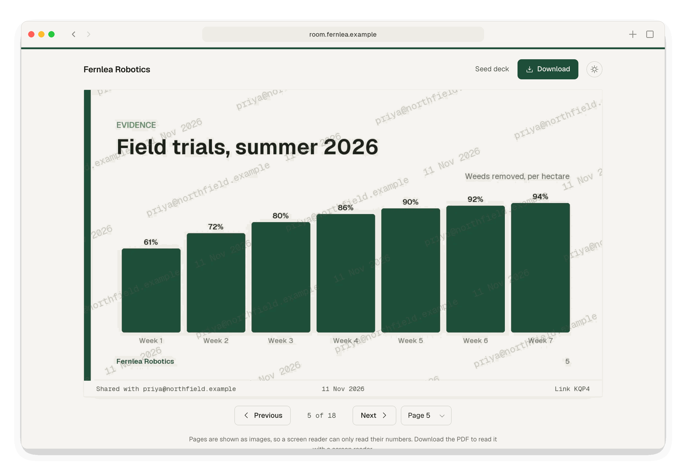
</picture>

A workbook is shown as a card with your description and its sheets, and a button to download it. Each copy has their email address, the date and the link written into its document properties.

<picture>
  <source media="(prefers-color-scheme: dark)" srcset="images/screenshots/workbook-dark.png">
  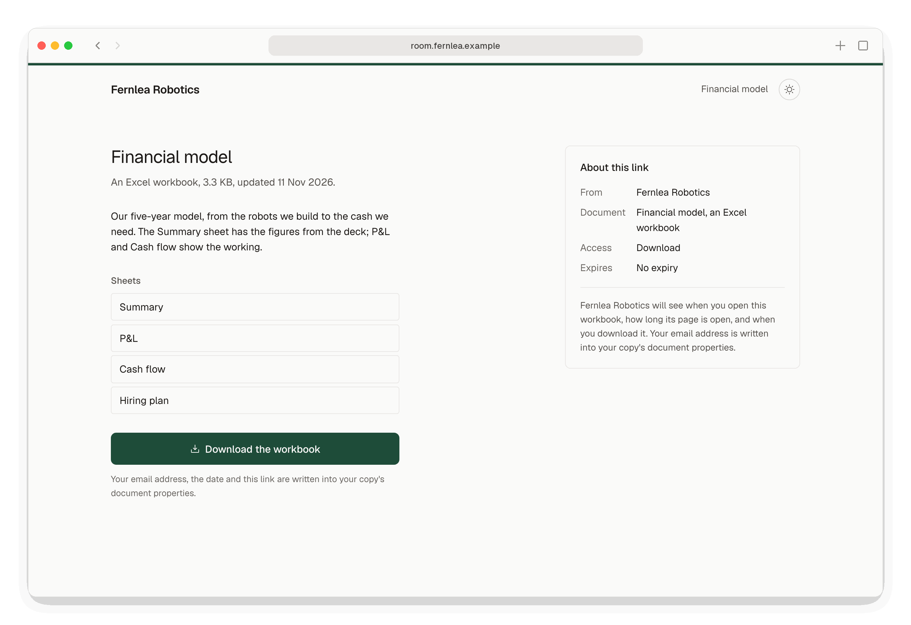
</picture>

## The audit log

The audit log lists everything admins and investors do, newest first: signing in, creating and revoking links, every code sent, every document opened and every download, with the address and country it came from. Filter it by kind or by email address, and export what you see as a CSV file. Nothing in it can be changed or deleted, by you or by Snug.

<picture>
  <source media="(prefers-color-scheme: dark)" srcset="images/screenshots/audit-dark.png">
  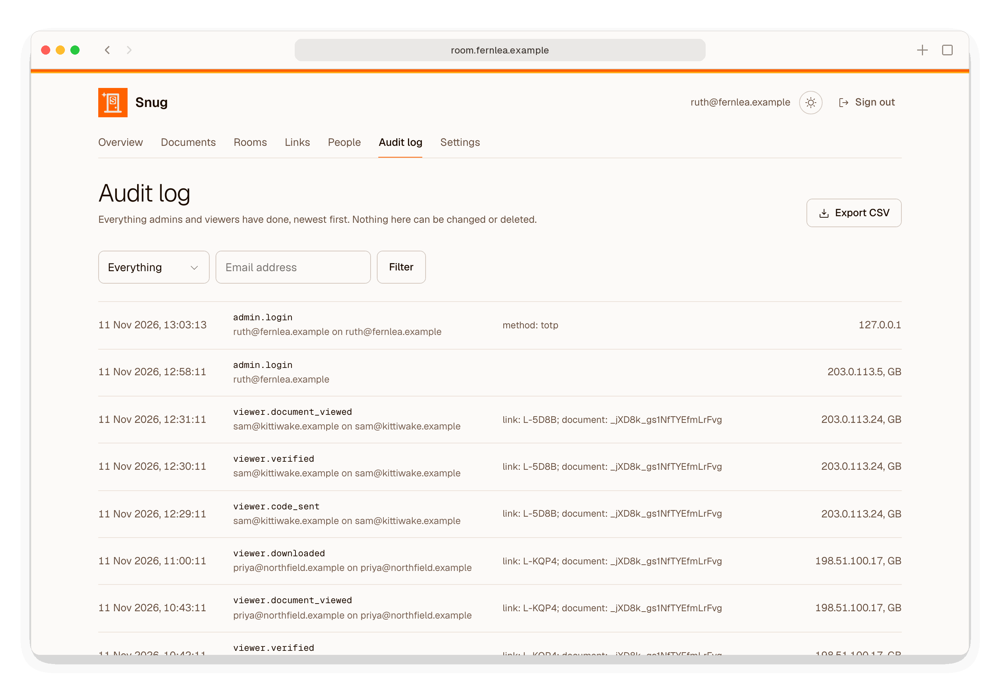
</picture>

## Settings

Settings holds the admins, your own account, email, branding, the NDA, the privacy policy link, how long reading data is kept, and when the backups last ran. Each section has a link to its guide.

<picture>
  <source media="(prefers-color-scheme: dark)" srcset="images/screenshots/settings-dark.png">
  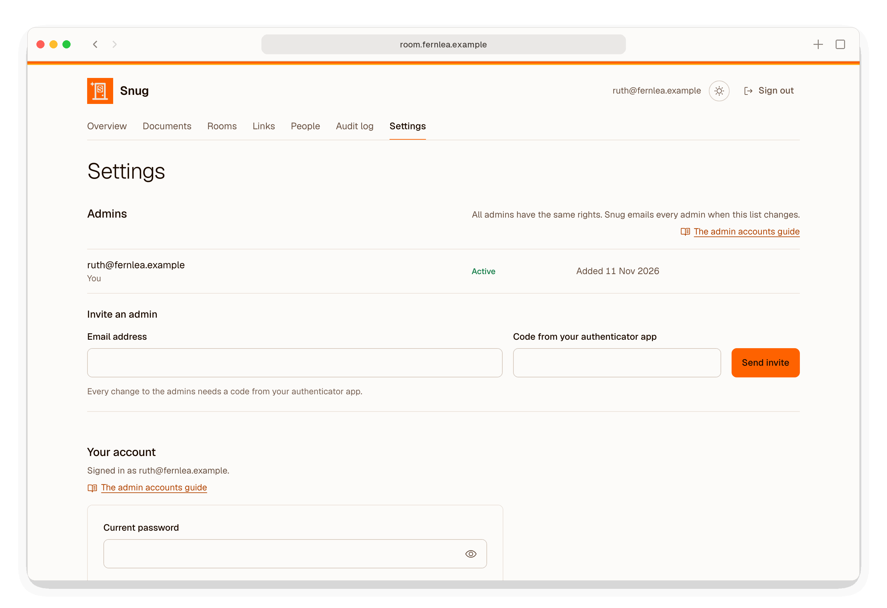
</picture>

Changing who the admins are, or how email is sent, needs a fresh code from your authenticator app, and every admin is emailed about it. Every admin is also emailed when you replace your authenticator, which takes a code from the old app or a recovery code. Changing your password needs a code too, and Snug emails you to confirm it. [Admin accounts](admin-accounts.md) has the details.

<picture>
  <source media="(prefers-color-scheme: dark)" srcset="images/screenshots/settings-account-dark.png">
  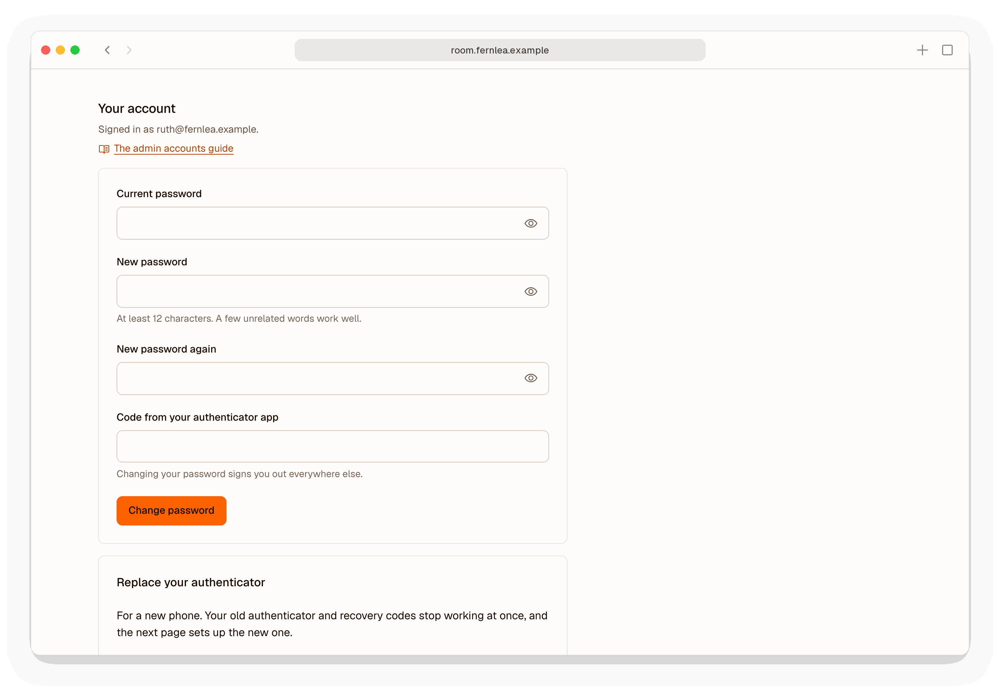
</picture>

Email is set up in numbered steps, ending with a test email, as in [the Google Workspace guide](email-google.md) or, for another provider, [the email guide](email.md).

### Branding

Branding sets how investors' pages look. Each part is saved on its own.

- **Company name**, shown at the top of investors' pages when there is no logo, and in every email Snug sends. `snug setup` asks for it first.
- **Accent colour**, for buttons and links on investors' pages. Snug adjusts it where needed to keep text readable, and the preview shows the result before you save. Leave it empty for Snug's own.
- **Logo**, a PNG or JPEG up to 2 MB, shown at the top of investors' pages. Untick *Show the name beside the logo* if the logo already spells it out.
- **Tab icon**, a square PNG or JPEG for investors' browser tabs. Without one, Snug uses your logo if it is roughly square, and otherwise your initial on your accent colour.

### Privacy and reading data

Beside each document, investors are told what you will see: when they open it, how long they spend on each page, and that every page shows their email address. To add a link to your own privacy policy there, enter its address under **Privacy policy address**.

**Keep reading data for** sets how long Snug keeps what each person read or watched once their link is revoked or expires: 12 months unless you change it, and anything from 1 to 120. While a link works, its reading data is kept. The link and the audit log are kept regardless.

### Backups

Backups shows when Snug last copied your documents and database to your bucket, or what went wrong. It is the same check as `snug doctor` on the server. [Backups](backups.md) explains how to restore from them.
